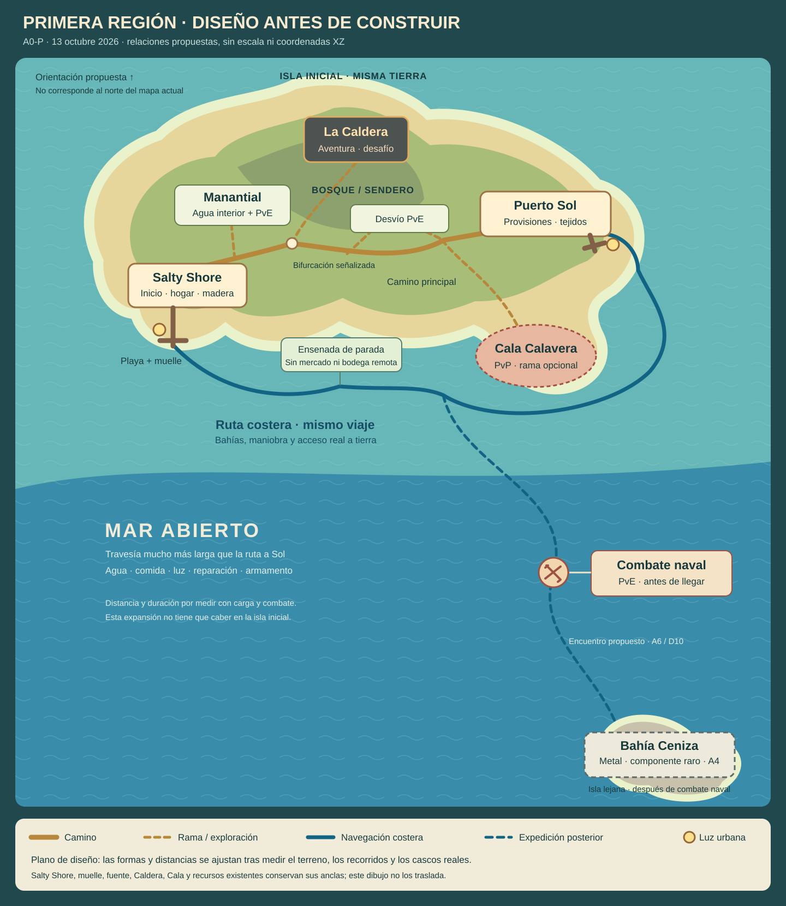

# Primera región — terreno, pueblos y recorridos

Fecha: 2026-10-13, hora de México. Corte documental **AREA01 / A0-P**.

**A0-G1 cerrado, 2026-10-13:** [levantamiento y propuesta concreta de Sol](docs/world/a0-g1/README.md),
[terreno medido](docs/world/a0-g1/terrain-survey.svg). Se compararon dos penínsulas reales;
se recomienda una extensión occidental para conservar la escala del recorrido. Sus cotas/
coordenadas nuevas aún son propuestas. Sigue **GM06a: contrato y prototipo privado de costa/bounds**.

El autor autorizó diseñar la geografía antes de construir la conexión con Puerto Sol.
Este documento concreta esa dirección con un plano provisional y una cola de trabajo.
La relación entre los tres pueblos ya estaba acordada; la silueta, orientación, distancias
y composición que se proponen aquí siguen siendo ajustables. El plano no es el mapa activo.

**Revisión del autor, 2026-10-13:** el esquema gusta; Bahía Ceniza debe estar **mucho más
lejos**, con una travesía que se adentre en mar abierto y exija luchar desde el barco para
llegar. El resto del esquema se conserva. Distancia, duración y encuentros concretos se
ajustarán al probar navegación y combate; Ceniza deja de ser un salto costero corto.

[Plano provisional SVG](docs/world/region-inicial-v1.svg) ·
[Plan de alfa](PLAN-ALFA-MUNDO.md) · [Dirección visual](PLAN-VISUAL-PORT.md) ·
[Editor y costa GM06](PLAN-GM-EDITOR.md#9-edición-y-ampliación-del-terreno) ·
[Dirección naval](docs/NAVAL-ROADMAP.md)

## 1. Experiencia que debe sostener el terreno

Llegar a Salty Shore, encontrar un hogar reconocible, salir por agua/materiales y aventura,
afrontar La Caldera y regresar con una mejora útil. La balsa abre otra manera de explorar,
transportar y habitar. Puerto Sol da una razón para cruzar la isla o rodearla por mar;
Bahía Ceniza abre una expedición posterior de mar abierto que exige preparación y combate naval.

La primera región debe servir tanto a quien quiere combate y poderes raros como a quien
construye, recolecta o comercia. El terreno conecta esas actividades: el camino de aventura
y el comercial comparten una salida inicial, después se bifurcan. La Caldera conserva
su papel de desafío; el viaje inicial a Sol no exige cruzar la arena ni una zona PvP.
Los agentes usan los mismos caminos, servicios y permisos que los personajes humanos.

Reservar la secuencia del primer capítulo: encargo legible en Salty Shore → salida por el
sendero → encuentro con recompensa visible → descubrimiento de una perla/poder raro →
desafío de La Caldera → regreso para aprovechar una mejora. Son los motivos del recorrido;
la ubicación exacta, probabilidades y garantía de conseguir una perla no se fijan aquí.

## 2. Qué está decidido y qué propone este corte

| Tema | Dirección acordada | Propuesta espacial de este documento |
|---|---|---|
| Pueblos | Salty Shore y Puerto Sol en una misma isla; Bahía Ceniza en otra, mucho más lejana | Isla inicial alargada, dos bahías en extremos de una costa, interior elevado y una isla minera tras una travesía de mar abierto |
| Salty Shore | Inicio, madera/piedra, pesca, viviendas, reparación y carpintería | Bahía abrigada; playa → plaza/servicios → muelle, con viviendas a un costado y salida libre hacia el interior |
| Puerto Sol | Tejidos/provisiones; necesita madera y alimentos | Bahía más abierta, mercado próximo al camino y al muelle; espacio reservado para tejeduría y velas |
| Bahía Ceniza | Mineral/metal; mar abierto lejano y combate naval antes de llegar; componente raro para el purificador avanzado | Puerto abrigado en isla rocosa, área industrial separada del desembarco; acceso tras A6/D10 y detalle en A4 |
| Agua inicial | Fuente interior con enemigos; cubeta, barril y cantimplora antes del purificador avanzado | Desvío corto desde la salida de Salty Shore, con combate local y un retorno claro para transportar reservas |
| Riesgo | Cala conserva su régimen propio; no exigir PvP para progreso doméstico básico | Camino a Sol con riesgo PvE anunciado y opción de retirarse/desviar; Cala en una rama separada |
| Noche | Exterior casi negro sin luz; fuentes utilizables y UI legible | Puertos como referencias de fuego permanente; oscuridad real entre refugios, sin iluminar todo el bosque o el mar |

El norte del dibujo es una orientación de presentación propuesta. Sus posiciones no son
coordenadas XZ ni sustituyen las anclas actuales. La forma final debe acomodarse al
levantamiento del mapa existente, conservando sus sectores funcionales.

## 3. Plano de relaciones

El trazo ocre representa el camino principal; el azul, la ruta costera. Las ramas del
manantial, La Caldera, bosque y Cala permiten explorar sin confundir el destino comercial.
La ruta a Ceniza cruza una franja amplia de mar abierto; navegación, combate y destino
quedan reservados para la fase posterior. El dibujo no representa
colisiones, alturas medidas, peligros ya colocados ni contenido publicado.

## 4. Sectores y motivos para detenerse

| Sector | Forma y lectura | Actividad y requisito |
|---|---|---|
| Playa y bahía de Salty Shore | Arena somera, entrada protegida, capitanía visible y muelle reconocible | Llegada sin combate obligatorio, orientación, primeras recogidas y acceso al pueblo |
| Núcleo de Salty Shore | Terrazas y rampas, plaza abierta, carpintería y mercado próximos | Usar servicios, aportar, fabricar, reparar y preparar la siguiente salida |
| Bosque cercano / manantial | Palmas, claros, roca y fuente en tierra interior | Preparar una expedición de agua; encuentro PvE cerca de la fuente, espacio para combatir y volver con cubeta |
| Bifurcación del interior | Hito visible y señalización: Sol, La Caldera y retorno | Elegir objetivo sin abrir constantemente el mapa; no mezclar señales comerciales con entrada a PvP |
| Sendero del Humo / La Caldera | Ascenso legible hacia basalto, humo y lava | Aventura, combate y descubrimiento; conservar entradas, checkpoints y arena existentes |
| Camino a Puerto Sol | Bosque menos denso, claros y paso por una cresta baja | Transporte pequeño, recursos y encuentros anunciados; ruta principal transitable sin saltos obligatorios |
| Desvío de bosque | Ruta lateral con campamento visible antes de entrar | Más exposición PvE y recolección; retirar o rodear sigue siendo posible. No heredar reglas de Cala |
| Costa entre puertos | Cabos reconocibles, arrecifes visibles y una ensenada de parada | Navegar con carga, leer costa, desembarcar/reembarcar. Reservar agua suficiente para maniobrar |
| Puerto Sol | Playa de acceso, muelle, mercado y espacio textil | Llegada a pie o en balsa al mismo pueblo y mercado; la fibra/tejidos nuevos necesitan su propio corte |
| Cala Calavera | Rama con aviso de peligro y frontera reconocible | Destino PvP opcional existente. Preservar su ubicación/ley hasta una migración específica |
| Mar abierto hacia Ceniza | Travesía claramente más larga que la ruta a Sol, lejos de la costa inicial | Preparar agua/comida/luz/reparación y afrontar enemigos desde el barco antes de llegar |
| Bahía Ceniza | Isla lejana, roca y puerto industrial | Llegar tras la expedición naval, metalurgia y componente raro. Evitar requisitos circulares entre ciudades |

La ensenada costera no es otra ciudad ni concede un mercado, teletransporte, amarre persistente
o acceso remoto a bodega. Su primera función sería una parada normal del mismo viaje;
[RNV08a](docs/briefs/RNV08a-shore-resupply.md) conserva sus límites hasta el contrato multipuerto.

## 5. Recorridos y escala para la primera prueba

Los tiempos siguientes son **objetivos para probar**, no resultados medidos ni un cambio a
las velocidades actuales. Se miden en ambos sentidos y a velocidad ordinaria, con carga
representativa. Las compras, lucha, acopio y decisiones se registran aparte del desplazamiento.

| Recorrido | Objetivo inicial propuesto | Qué debe demostrar |
|---|---|---|
| Playa → plaza/servicio inicial | 20–40 s caminando | Orientación clara; llegada útil sin una caminata vacía larga |
| Plaza → manantial → plaza | 2–4 min de salida completa, incluido un encuentro breve | Agua para varios usos por expedición; no combatir por cada sorbo ni poner enemigos en el spawn |
| Salty Shore → Puerto Sol por camino | 2–4 min de desplazamiento por sentido | Mochila y entrega pequeña útiles; terreno/pendiente/carga medidos antes de fijar distancia |
| Salty Shore → Puerto Sol por costa | 90–180 s navegando por sentido, objetivo heredado del plan alfa | Capacidad de carga útil y maniobras reales; sumar preparación, carga, atraque y venta al comparar rutas |
| Salty Shore → La Caldera → regreso | Primer capítulo de aventura, duración por medir | Desafío y mejora útil; encuentro completo antes de ajustar longitud del sendero |
| Puerto → Ceniza | Travesía de mar abierto mucho más larga que Salty–Sol; duración por medir en A4 con carga y combate | Alejarse de la costa, luchar desde el barco y llegar con capacidad para retornar; registrar navegación y encuentros por separado |

Mantener la propuesta alfa de un núcleo urbano de 100–140 u, plaza abierta de 30–45 u
y corredores principales de 5–6 u como **presupuesto de maqueta jugable**, sujeto a cámara y cuerpos
reales. La envolvente regional de 800–1.000 u por lado del plan alfa deja de ser una
restricción para incluir Ceniza: primero medir la isla inicial/ruta a Sol y después dimensionar
su expansión oceánica. El mundo actual tiene 560 u. No se convierte en una rejilla nueva de
detalle uniforme ni se comprime Ceniza para hacerla caber en ese presupuesto anterior.

El canal, la zona de giro y el desembarco se dimensionan con la balsa de ensayo más grande
y cargada del corte. Primero comprobar una llegada completa; después concurrencia/amarres
con AREA16. Ocho personajes/balsas es una meta de capacidad, no una aceptación de este plano.

### Expedición a Ceniza: preparación, combate y regreso

Secuencia de diseño: preparar la nave en Salty Shore/Puerto Sol → dejar atrás la costa →
enfrentamiento naval en mar abierto → aproximación a Ceniza → desembarco y abastecimiento →
regreso. La distancia debe dar espacio a maniobrar y tomar decisiones, no añadir minutos
vacíos. Los enemigos, su número, ritmo y comportamiento se diseñan con el primer rival naval.

La base propuesta es **combate PvE naval**, con enemigo móvil vencible, arma propia utilizable,
señales legibles, daño/reparación y opción de retirarse para volver a preparar la expedición.
Luchar en barco forma parte de la llegada a Ceniza; si el jugador se retira, aún no completa
el acceso. No se exige PvP, victoria sobre humanos ni abordar una nave ajena.

El primer equipo capaz de superar ese encuentro debe poder prepararse con recursos y
servicios accesibles desde Salty Shore/Sol. El metal o componente raro que se busca en
Ceniza no puede ser requisito del arma/casco/reparación necesarios para alcanzarla.
La expedición completa se acepta después de A6/D10; el purificador avanzado sigue siendo
una mejora posterior a conseguir su componente allí. Formato del encuentro, pérdidas,
custodia y liquidación se concretan con AREA15 antes de exponer bienes públicos.

## 6. Luz, agua y abastecimiento como parte de la geografía

Las ciudades tendrán luces municipales permanentes, sin combustible. Cada puerto debe
tener una referencia visible desde su aproximación y luz útil alrededor de servicios y
pasarelas. Su alcance no elimina la oscuridad del exterior ni convierte la costa en una
carretera iluminada. El faro físico y sus colisiones/luz requieren una entrega propia.

Las antorchas de mano conservan la duración acordada de 20 min encendidas; luces de
casa/barco, 60 min por madera. El código de fuego actual mantiene esas duraciones y la
receta portátil de 2 troncos + 1 resina; este plano no altera combustible ni balance.
Fogatas/parrillas conservan su consumo propio. Ubicar puntos de preparación, espacios
de combate y señales que se lean con luz local también en móvil/calidad baja.

La fuente inicial sigue siendo `salty-spring`; los recipientes y su agua conservan identidad
y contenido. La maqueta usa su ubicación actual: dibujar el manantial en el interior
no autoriza trasladarlo. Una fuente futura en Sol sería contenido adicional explícito,
con ID y acceso propios; no nace por pintar un lago ni por mover una etiqueta.

El purificador avanzado depende de la tercera ciudad y de su componente raro. El plano
reserva esa cadena en Ceniza, pero no elige receta/coste/tasa de aparición nuevos ni
declara retirada la implementación anterior del purificador.

## 7. Estado del proyecto que limita la construcción

Lectura de código en `a442489bbed4ec33ed9ba31e50250f781e39c0c1`, versión declarada
alpha.67/protocolo 60. Es una inspección del repositorio; este corte no consultó el VPS.

| Sistema | Base comprobada en archivos | Trabajo necesario para el mapa nuevo |
|---|---|---|
| Terreno | Generador legacy de 400 u; postpass S21 de 560 u, rejilla 561×561 | Levantamiento y plano con cotas/anclas; crear costa o ampliar dominio pertenece a GM06 |
| Pueblos | `aldea` y `cala` caminables; `sol`/`ceniza` y otros destinos tienen mercados económicos | Puerto Sol necesita terreno, puerto, mercado físico y acceso real; cambiar `island` no los crea |
| Editor | Escultura/pintura de suelo seco, decoración, recursos funcionales con IDs y borradores | La costa/servicios/rutas protegidas no se pueden rediseñar con los pinceles actuales; contrato GM06/adaptador de anclas |
| Mapas | Minimapa y mapa grande comparten cartografía y admiten bounds/revisiones explícitos | Declarar bounds completos y POIs reales; revisar el encuadre legacy, invalidar atlas y probar costas nuevas |
| Navío | Circuito físico desde el muelle actual y paradas/reembarque | Navegación a Sol, atraque/descarga multipuerto y retorno; distinguir viaje físico de viaje económico temporizado |
| Estado guardado | Economía/recursos por IDs; contenido GM por base/revisión; checkpoints de personaje y poses guardadas de viaje de balsa | Compatibilidad explícita entre bases/anclas. Conservar mercados, agua, casas, recursos y progreso de perfil; resolver sesiones de ruta en curso por separado |

Fuentes: [worldgen](src/sim/worldgen.js), [S21](src/sim/terrainRevamp.js),
[pueblos](src/data/towns.js), [fuente/recipientes](src/data/freshwater.js),
[identidad base GM](src/editor/baseIdentity.js), [cartografía](docs/delivery/cartography.md)
y [contrato de escultura](docs/briefs/gm05a-terrain-sculpt.md).

El levantamiento debe registrar `cartography.bounds` en coordenadas **XZ de mundo**.
El encuadre legacy usa `mapSpan: 255` en el marco UV y no cubre necesariamente los extremos
de la rejilla de 560 u; no usarlo como límite del terreno nuevo. El progreso de misiones y
checkpoint del perfil se distingue del ensayo naval `NavalRoute.#runs`, que vive en memoria.
Activar otro terreno necesita resolver tanto el viaje guardado como el ensayo transitorio.

## 8. Contrato para poder cambiar de mapa después

La identidad del lugar y su posición deben ser datos separados. Mantener `aldea`, `sol`,
`ceniza` y `cala` como identidades económicas; un cambio de nombre o ubicación no crea otra
ciudad. Los nombres visibles, anclas físicas y servicios se vincularán al mismo ID.
Los ejemplos de IDs nuevos del siguiente contrato son propuestas, no campos implementados.

| Dato | Contrato del próximo corte |
|---|---|
| Base geográfica | Semilla, revisión/hash de terreno y bounds explícitos; un marco XZ compartido por host, renderer, colisión y cartografía |
| Isla/región | Identidad estable; huella y límites separados. El sector es parte del mismo mundo, no otra copia de economía |
| Pueblo/puerto | ID de pueblo existente, anclas de mercado/plaza/muelle y accesos asociados. Sin cotizar o descargar desde un simple POI lejano |
| Fuente/refugio/encuentro | ID independiente de coordenadas y de decoración; radio/altura/acceso comprobados por servidor |
| Recursos | Conservar los IDs heredados y el estado de agotamiento/contribuciones; nuevas colocaciones usan el contrato GM funcional existente |
| Contenido GM | Base exacta y mapa de correspondencia al cambiar base: sus IDs legacy incluyen transformación/índice, no son independientes de posición |
| Personajes/barcos | Misma identidad, carga, agua, HP y progreso. Resolver poses/viajes en curso antes de activar una base incompatible |
| Mapa/minimapa | Una fuente de geografía activa, bounds completos y revisión de atlas; un esquema dibujado nunca sustituye `groundAt`/colisiones |

Primera política propuesta: conservar llegada, muelle, Salty Shore funcional, manantial,
La Caldera/Cala, recursos y coordenadas existentes; buscar el emplazamiento de Sol en suelo
libre o en una extensión nueva tras el levantamiento. El plano relacional no mueve esos
lugares. No regenerar la base con otra semilla para conseguir una silueta más bonita.

Antes de mover un ancla ocupada, diseñar la transición con AREA15: base previa/nueva,
correspondencia por ID, poses válidas, operaciones pendientes y recuperación. La activación
usa el mecanismo de contenido existente y no puede dejar una compra/entrega sin resolver.
Una reconexión o rollback no repone stock, contribuciones, nodos agotados ni recompensas.
Guardar un borrador y activar una geografía siguen siendo acciones distintas.

Los seis mercados y el grafo `LANES` legacy se conservan hasta resolver compatibilidad;
terminar un viaje temporizado antiguo no prueba llegada al futuro muelle físico de Sol.
El corte A3 tendrá que especificar cómo conviven o terminan esos viajes antes de habilitar
el transporte físico, incluida la recuperación de quienes estaban desconectados.

## 9. Arte y herramientas que se reutilizarán

El plano es SVG editable y ligero, sin texturas, modelos nuevos ni dependencias del juego.
Para la maqueta reutilizar alturas/materiales, rocas/palmas, rampas y muelle actuales;
las cajas existentes ayudan a identificar carga. Escultura, pintura y recursos GM sirven
en las zonas que ya admiten edición; no se eluden sus protecciones para hacer la costa.

La caja Dreamrise `prop:storage-crate`, atlas de madera ilustrada y modelos recientes
de antorcha/cocina ya tienen consumidores. `SM_SmallWoodeHut` y `SM_RepairBench`
siguen como candidatos: una casa prefabricada no acredita un kit modular ni una estación
funcional. Los objetos de cocina de la biblioteca GM no se convierten automáticamente
en máquinas de agua, cocción o producción por colocarlos.

Revisar el candidato concreto de muelle/faro/puesto/textiles al abrir su corte visual.
No exportar/modificar fuentes Unreal en esta planificación. La primera validación visual
será un rincón de costa–muelle–servicio legible, con huella/colisión y variantes móvil/PC;
después se extiende el kit al pueblo. Ver [inventario](docs/research/unreal-assets/CANDIDATES.csv),
[portabilidad](docs/research/unreal-assets/PORTABILITY.md) y
[modelos recientes](docs/delivery/item-models-v1/DELIVERY.md).

## 10. Orden concreto de construcción

| Corte | Entregable | Criterio para continuar |
|---|---|---|
| **A0-P — este documento** | Diseño de relaciones, plano, dependencias y propuestas diferenciadas | Documento/plano revisables; no modifica el mundo activo |
| **A0-G1 — levantamiento y anclas, cerrado** | [Plano medido, inventario y matriz](docs/world/a0-g1/README.md); S1/S2 comparados con reserva S3 al oeste | Base 560 u medida; S3 recomienda bounds X [-840,280], Z [-280,280], mismo mercado `sol`. Expansión propuesta, sin activar |
| **GM06a — siguiente, contrato de costa/bounds** | Nueva tierra/costa occidental sobre base versionada; samplers, bordes, agua, navegación, mapas y borradores concordantes, primero en prototipo privado | Determinismo, costes de rejilla/chunks, continuidad de áreas previas y publicación/rollback comprobados antes de ampliar |
| **A0-G2 / A3a — terreno y accesos provisionales** | Relieves simples, camino, rampas, bahías, zona de maniobra y entrada de Sol; conservar funcionales existentes | Recorrer realmente a pie y en balsa; sin teletransportes de QA para aceptar la ruta. Cotas, colisión y noche comprobadas |
| **A3b — Puerto Sol físico mínimo** | Mercado existente ligado a ancla real, plaza/muelle y servicio útil; llegada por tierra y costa | Mismo mercado/stock desde ambas entradas, distancia/permisos/reentrada; no duplicar economía |
| **AREA07/08 — viaje comercial completo** | Cargar en origen, viajar, atracar, acceder a carga con permiso, vender/descargar, volver | Conservación y recibos M5, respuesta perdida y reinicio. No basta abrir el mercado de mochila en una parada |
| **A3c — corredor y vida regional** | Señales, recursos/encuentros PvE, una cadena textil sin dependencias circulares | Retirada/rutas alternativas, materiales no duplicados y motivo real para comercio; balance medido |
| **A6/D10 — combate para la expedición** | Rival NPC móvil vencible, arma disponible desde Salty/Sol, daño a piezas, reparación y retirada | Combate real desde el barco y regreso para reparar; continuidad de carga/daño. Prerrequisito de la primera llegada a Ceniza |
| **A4 — isla lejana de Ceniza** | Expansión de mar abierto, segundo terreno/isla, puerto, abastecimiento y componente raro | Travesía larga + combate naval + llegada/desembarco + retorno conservados; después receta avanzada del purificador |

La composición visual detallada acompaña los cortes con espacio jugable aceptado. Casa,
astillero, parcelas y reservas multipuerto mantienen sus contratos propios. Este orden no
reabre los sistemas que ya funcionan ni reemplaza las entregas paralelas de GM/AREA15.

## 11. Aceptación del mapa jugable posterior

- Playa → plaza → taller/mercado → muelle y salida interior con inputs normales, en PC y touch.
- Ida/vuelta a Sol por camino y costa, mismo mundo/personaje/mercado; tiempos y carga registrados.
- Fuente interior: encuentro real, recogida, transporte y reserva/consumo; sin enemigos forzados en spawn.
- Primer capítulo de aventura: encargo, recompensa visible, descubrimiento de poderes raros y regreso con mejora; reglas de obtención en su corte de contenido.
- Sendero/Caldera y Cala existentes accesibles y conservados; frontera PvP claramente anunciada.
- Casco de ensayo cargado entra, gira y desembarca sin atravesar terreno ni perder al ocupante.
- Ceniza: salir de la costa, superar el encuentro desde el barco, llegar y volver con estado conservado; preparar el equipo inicial sin recursos exclusivos de Ceniza.
- Minimap y mapa grande muestran la misma costa, bounds, destino y posición que servidor/renderer.
- Noche legible con luz utilizable en bajo/móvil; exterior oscuro y faros municipales con cobertura acotada.
- Guardar, reiniciar, reentrar y cambiar/volver de revisión conserva estado e identidades; errores/reintentos sin duplicados.
- Medir memoria, coste de sim/dibujo/red y peor escena. Emulación no acepta FPS de teléfono físico ni cupo nuevo.

## 12. Estado de cierre de A0-P

Documento y esquema de relaciones preparados el 2026-10-13. Las comprobaciones del corte
se limitan a consistencia con planes/código, enlaces locales y lectura visual del SVG.
No hay terreno nuevo, Puerto Sol caminable, migración, cambio de versión/protocolo o
activación de contenido por este trabajo. Su continuación **A0-G1** ya tiene el
[levantamiento cerrado](docs/world/a0-g1/README.md): base/anclas medidas, rutas geométricas
y reserva occidental de Sol. El siguiente corte es **GM06a**, antes de moldear el corredor.
