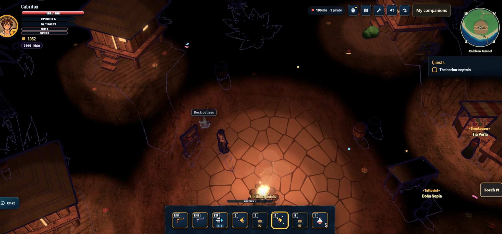
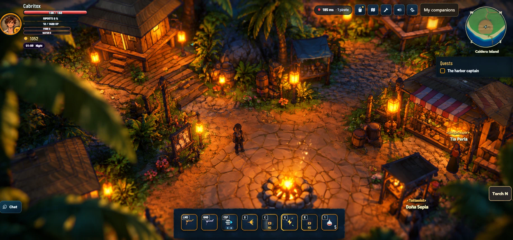

# Revamp visual: aldea de noche (diorama cómic cinematográfico)

Objetivo: que la plaza de Salty Shore de noche se vea como la referencia, conservando el toon y el contorno de tinta del juego.

- Antes (0.6.0-alpha.70, noche, plaza de la fogata): 
- Referencia objetivo (ilustración aportada por el autor, 2026-10-18): 

Pases del revamp, en orden: harness de captura fija (tools/shot.mjs, escenario `village-night`), luz nocturna (pozas suaves, rebote cálido, relleno marino), vestido de la plaza (postes-farol, vallas, tablón, macetas, puesto con toldo), hierba de borde, luciérnagas y neblina, suelo de adoquín, DOF.

Assets 3D del lote (Tripo, conceptos en asset-staging/tripo/<nombre>/concept.png): lantern-post, fence-rope, notice-board, crate-stack, planter-flowers, fern-cluster, broadleaf-plant, flower-bush, campfire-ring, stall-tarp.
