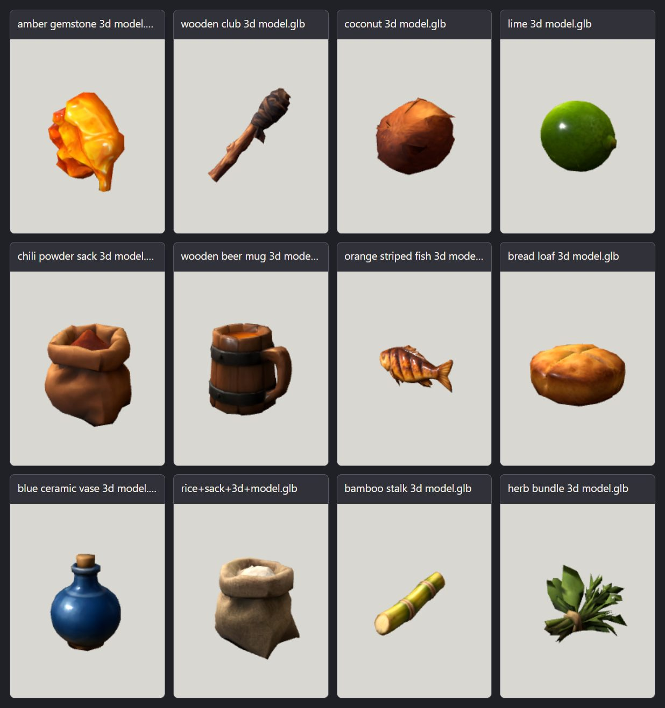

# Visual review and candidate mapping

The thumbnail sheet below renders the 12 downloaded GLBs with a neutral light and their embedded materials. It is a source preview, not an in-game or final art acceptance capture.

I compared the rendered forms and their base-color maps with the current painted item references in `docs/art/torch-resin-coconut-v1/` and `docs/art/cooking-icons-v1/`. The texture sheets alone are UV layouts, so the mapping below uses the rendered object silhouettes and visible contents as well as those references.

| Download | Plausible existing match | Confidence and visual basis |
|---|---|---|
| `amber gemstone 3d model.glb` | `resina` | **Conditional.** Amber-orange color and irregular hanging lower lobe resemble the resin reference. The rendered mesh reads as a hard, crystalline gemstone with bright gloss; the reference is one cohesive sticky resin blob. Needs a material/style review before acceptance. |
| `wooden club 3d model.glb` | `antorcha` | **Strong shape match.** The preview shows a branch handle and dark wrapped head, with no fire, matching the unlit torch reference. Despite the filename, it reads as a hand torch. |
| `coconut 3d model.glb` | `coco` | **Strong subject match.** Whole closed brown coconut with husk; the downloaded shape is rounder and less elongated than the existing painted reference. |
| `lime 3d model.glb` | proposed `lima` | **Strong subject match.** Single whole green lime. The proposal is not an approved gameplay item. |
| `chili powder sack 3d model.glb` | `especias` | **Strong subject match.** Open burlap sack containing orange-red ground spice, matching the existing sack icon. |
| `wooden beer mug 3d model.glb` | `meal_grog` | **Strong presentation match.** Open wood-and-metal tankard visibly contains amber drink, like the grog image. Treat as a presentation mesh for the prepared meal; it does not represent the ron bottle or a new stored good. |
| `orange striped fish 3d model.glb` | `meal_roastFish` | **Strong subject match.** A whole fish with dark grilled bands; the source icon is also a grilled striped fish. |
| `bread loaf 3d model.glb` | `meal_heartyBiscuit` | **Author-confirmed mapping (2026-10-12).** A round baked item suits the prepared-biscuit presentation slot. Remaining uncertainty is semantic identity (loaf/bun versus biscuit). |
| `blue ceramic vase 3d model.glb` | `agua` | **Author-confirmed mapping (2026-10-12).** Its blue stoppered silhouette fits the water-jar reference; the ceramic finish and lack of visible water leave a semantic mismatch. |
| `rice+sack+3d+model.glb` | `harina` | **Author-confirmed mapping (2026-10-12).** The white-filled sack matches the flour reference's silhouette, while the source name and visible grains read as rice. |

The author confirmed all three item identities on 2026-10-12. The descriptions above retain the initial silhouette review; no item behavior or cooking recipe changes with the mapping.
| `bamboo stalk 3d model.glb` | `cana` | **Strong shape match.** Short green segmented cane with cut ends, close to the sugar-cane reference. |
| `herb bundle 3d model.glb` | proposed `hierbas_aromaticas` | **Strong subject match.** Bound leafy green bundle. This remains a proposal, not an implemented resource. |

## Art direction and optimization

The current item references are hand-painted game illustrations with broad readable brush marks and controlled highlights. These meshes use smooth PBR response, glossy highlights, detailed normal maps, and dense realistic texture variation. They carry the right subjects, but importing the materials unchanged would weaken the established graphic, Borderlands-inspired direction. Keep the downloaded GLBs as untouched source evidence; make game derivatives with broader color planes, restrained roughness/shine, and the current toon treatment. Use a stronger contour only where the in-game render confirms it helps readability.

Geometry is already modest: 402–692 triangles each, below the repo's 6,000-triangle prop ceiling. The antorcha/resina/coco counts (498/472/402) are also within their narrower art brief targets (about 1,000 for torch and 500–800 for resin/coconut). Do not decimate these as the first optimization step.

Most candidates package a 2048×2048 base-color, roughness/metallic, and normal map; the rice sack uses three 1024×1024 JPG maps. For the handheld and food scale, prepare a 512px desktop base-color derivative and a 256px mobile derivative, per the item-art brief. The current assets guide already uses `@gltf-transform/cli optimize` with Meshopt and WebP; the `tools/gm-assets` workspace also pins glTF Transform 4.5.0 and Sharp 0.35.5. For these small stylized props, test a derivative that retains base color, drops unused normal/roughness maps where the toon material supports it, resizes and compresses color textures, and uses Meshopt. Keep each original intact and compare rendered screenshots before registration. `tools/import-asset.mjs --dry` can inspect a candidate, and `tools/look.mjs` can capture a lineup after a derivative is staged.

The 12 canonical source GLBs are archived under `docs/art/source/`, and each has desktop/mobile derivatives. Original downloads remain untouched in Downloads. This report records asset preparation evidence; manifest registration was handled separately, and publication remains separate.
