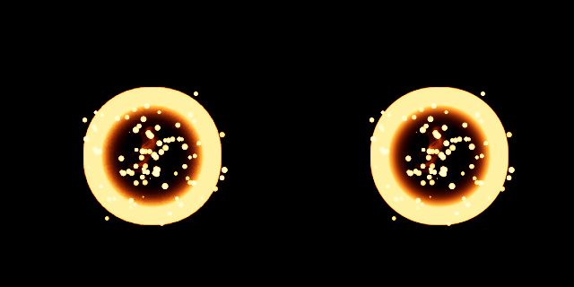

# NS_BasicHit: la llama contra una superficie opaca (T-1023-06)

Pendiente de RENDER.md ("DepthFade de la llama contra una superficie: la referencia no tiene superficie y la llama se
dibuja sin DepthFade"). `basichit-reference12` (T-1023-01, par con `-14`) captura `NS_BasicHit` en Unreal con un plano
opaco, negro, sin luz y de dos caras (3000 cm) delante, en el objetivo y detrás de la cámara, en los pasos 6 y 12, tres
cámaras ortográficas. Esta entrega dibuja esas 32 poses con la cadena nativa, con el DepthFade de la llama a 100 cm, y las
mide con los umbrales del autor del 2026-10-21. Nada de lo que sigue mueve el gate de RENDER.md ni el conjunto `wrap`.



Paso 12, `side_wall0` (el plano pasa por el objetivo), recorte de 320 x 320 px en (318, 326) de los dos lienzos de 1024 px,
sin remuestreo; `FinalColorLDR` de `basichit-reference12` a la izquierda y la cadena nativa de `t1023-06-depth-a` a la
derecha. Es la pose donde el DepthFade cambia más el resultado (ver abajo); a simple vista las dos mitades son iguales.

## Resultado

- La precondición de transferencia pasa en las 16 poses del paso 12 (3 controles y 13 planos): MAE <= 0,046/255
  (peor fila `t0012_oblique_wall-25`) y P95 0, frente a 2 y 4.
- Las 32 filas nativas (6 controles y 26 planos) pasan con IoU de máscara >= 0,94 y MAE <= 10/255: 30 filas de
  evidencia con IoU >= 0,9939 y MAE <= 1,513/255, y 2 filas con la unión visible vacía en las dos
  imágenes (`emptyUnion`: `t0006_front_wall-25`, `t0006_oblique_wall-25`), que pasan y se cuentan aparte.
- Con los umbrales del autor el gate apenas separa el DepthFade: con la llama sin DepthFade (el plano sigue ocultando)
  25 de las 26 poses seguirían pasando. Solo `t0012_side_wall0` cae a IoU 0,9625 y MAE 12,502/255, fuera de los dos
  umbrales, frente a 0,9948 y 1,211 con él. El error sí lo separa: sin DepthFade 10 de las 26 poses empeoran (MAE hasta
  12,502 frente a un máximo de 1,513 con él) y 16 quedan iguales (planos a -25 y a 150 cm, y a 0 cm en las vistas frontal
  y oblicua).
- Identidad de la referencia: en las 13 profundidades de Unreal el máximo de |profundidad de Unreal - plano analítico| es
  0,0252 cm (`t0006_oblique_floor`), muy por debajo de 1 cm; las paredes frontal, oblicua y lateral y el suelo son los de
  las filas, no solo el centro de imagen.
- Dos ejecuciones del laboratorio idénticas (`t1023-06-depth-a` y `-b`: 75/75 lienzos y `comparison.json` byte a byte); los 6
  controles son píxel a píxel los lienzos del gate (mismo paso y cámara). Gate y `wrap` no cambian: `t1023-06-gate-a` da
  49/49 lienzos iguales a `t1022-33-c` y `comparison.json` `ffd36cdb...`; `t1023-06-wrap-a` da `5e87ea9a...`.

## Qué se construyó

- Conjunto `depth` en `basichit.html?reference=depth`, `qa-basichit.mjs ... depth` y `compare-basichit.py --reference depth`:
  lee `depth-reference-checkpoint.json` y `basichit-reference12`, y comprueba el sha256 de cada archivo que lee. El gate y
  `wrap` no cambian (`BASICHIT_LAYERS` sigue sin DepthFade; los lienzos y `comparison.json` de los dos son los mismos).
- `basichit-depth.js`: `planeFromSurface(surface)` da el centro (`pointCm` en ejes de escena), la normal unitaria y los 30 m del
  plano de una fila; `BasicHitDepthStage` sigue el patrón de `depth-stage.js` del piloto (DEPTH-LAB.md): el plano se dibuja en
  un destino aparte con textura de profundidad `NearestFilter`, luego en el destino HDR principal para que oculte, y las
  partículas van sin escribir profundidad; una textura asociada al framebuffer activo nunca se muestrea. Solo ortográfica.
  Un control pasa por la misma ruta con el pase opaco vacío (profundidad = plano lejano, factor 1).
- `BASICHIT_DEPTH_LAYERS` (`basichit-render.js`): la llama con `depthFade: 1` (100 cm, el `fade_distance_default` de
  `material-defaults.json`); Flash y SimpleBurst son los mismos objetos que en el gate. La opacidad es
  `saturate(alfa * tex.r) * saturate((SceneDepth - PixelDepth) / 100 cm)`: en `M_Smoke.t3d` (31-32) el `InOpacity` del
  DepthFade es el `Clamp`, como en `core/sprite-shader.js`. `core/` no cambia. `BasicHitParticles` acepta la lista de capas
  y `setDepth(...)`.
- Orden de dibujo del veredicto: el del gate (Flame, Flash, SimpleBurst).
- `compare-basichit.py`: filas de transferencia y nativas para controles y planos; `emptyUnion` (unión visible, canal
  máximo > 8, vacía en las dos imágenes: pasa y se cuenta aparte; vacía en una sola: falla, el IoU es 0); diagnósticos con el
  DepthFade apagado junto a la fila con él; `depthIdentity`: la profundidad de Unreal contra la intersección analítica del
  rayo ortográfico de cada píxel (cámara con el `forward` hacia el objetivo, `right` = Z x forward, centros de píxel) con el
  plano de la fila, sobre los píxeles que el plano cubre (profundidad < 1e5 cm).

## Filas nativas y diagnóstico sin DepthFade

IoU de máscara / MAE (/255) del lienzo nativo (gate, llama con DepthFade) y, para los 26 planos, el mismo par con la llama
sin DepthFade (el plano sigue ocultando). Umbrales: IoU >= 0,94 y MAE <= 10.

| caso | IoU máscara | MAE /255 | unión vacía | sin DepthFade: IoU / MAE |
|---|---|---|---|---|
| `t0006_front` | 0.9983 | 1.401 | no | — |
| `t0006_front_wall-25` | — | 0.000 | sí | — / 0.000 |
| `t0006_front_wall0` | 1.0000 | 0.034 | no | 1.0000 / 0.034 |
| `t0006_front_wall50` | 0.9985 | 1.348 | no | 0.9983 / 1.774 |
| `t0006_front_wall150` | 0.9983 | 1.401 | no | 0.9983 / 1.401 |
| `t0006_oblique` | 0.9978 | 1.428 | no | — |
| `t0006_oblique_wall-25` | — | 0.000 | sí | — / 0.000 |
| `t0006_oblique_wall0` | 0.9993 | 0.056 | no | 0.9993 / 0.056 |
| `t0006_oblique_wall50` | 0.9978 | 1.342 | no | 0.9972 / 1.631 |
| `t0006_oblique_wall150` | 0.9978 | 1.428 | no | 0.9978 / 1.428 |
| `t0006_oblique_floor` | 0.9967 | 1.355 | no | 0.9964 / 1.842 |
| `t0006_side` | 0.9984 | 1.355 | no | — |
| `t0006_side_wall-25` | 1.0000 | 0.059 | no | 1.0000 / 0.059 |
| `t0006_side_wall0` | 0.9939 | 1.406 | no | 0.9886 / 4.124 |
| `t0006_side_wall50` | 0.9982 | 1.330 | no | 0.9982 / 1.447 |
| `t0006_side_wall150` | 0.9984 | 1.355 | no | 0.9984 / 1.355 |
| `t0012_front` | 0.9963 | 1.436 | no | — |
| `t0012_front_wall-25` | 1.0000 | 0.044 | no | 1.0000 / 0.044 |
| `t0012_front_wall0` | 1.0000 | 0.042 | no | 1.0000 / 0.042 |
| `t0012_front_wall50` | 0.9961 | 1.468 | no | 0.9934 / 5.555 |
| `t0012_front_wall150` | 0.9963 | 1.436 | no | 0.9963 / 1.436 |
| `t0012_oblique` | 0.9967 | 1.497 | no | — |
| `t0012_oblique_wall-25` | 1.0000 | 0.047 | no | 1.0000 / 0.047 |
| `t0012_oblique_wall0` | 1.0000 | 0.046 | no | 1.0000 / 0.046 |
| `t0012_oblique_wall50` | 0.9960 | 1.485 | no | 0.9936 / 4.603 |
| `t0012_oblique_wall150` | 0.9967 | 1.497 | no | 0.9967 / 1.497 |
| `t0012_oblique_floor` | 0.9966 | 1.513 | no | 0.9914 / 4.852 |
| `t0012_side` | 0.9966 | 1.480 | no | — |
| `t0012_side_wall-25` | 1.0000 | 0.042 | no | 1.0000 / 0.042 |
| `t0012_side_wall0` | 0.9948 | 1.211 | no | 0.9625 / 12.502 |
| `t0012_side_wall50` | 0.9961 | 1.472 | no | 0.9944 / 3.447 |
| `t0012_side_wall150` | 0.9966 | 1.480 | no | 0.9966 / 1.480 |

Transferencia en el paso 12 (Filmic del laboratorio sobre el HDR crudo frente al LDR de Unreal, 16 poses): MAE
0.024-0.046 y P95 0; identidad de la GPU frente a la transformación exacta de `film-color.js`: MAE <= 0.175, P95 <= 1.

Identidad de la profundidad (13 archivos del paso 6; píxeles cubiertos, error en cm):

| caso | píxeles cubiertos | error máximo | error medio |
|---|---|---|---|
| `t0006_front_wall-25` | 1048576 | 0.0000 | 0.0000 |
| `t0006_front_wall0` | 1048576 | 0.0000 | 0.0000 |
| `t0006_front_wall50` | 1048576 | 0.0000 | 0.0000 |
| `t0006_front_wall150` | 1048576 | 0.0000 | 0.0000 |
| `t0006_oblique_wall-25` | 1048576 | 0.0000 | 0.0000 |
| `t0006_oblique_wall0` | 1048576 | 0.0000 | 0.0000 |
| `t0006_oblique_wall50` | 1048576 | 0.0000 | 0.0000 |
| `t0006_oblique_wall150` | 1048576 | 0.0000 | 0.0000 |
| `t0006_oblique_floor` | 883712 | 0.0252 | 0.0148 |
| `t0006_side_wall-25` | 1048576 | 0.0000 | 0.0000 |
| `t0006_side_wall0` | 1048576 | 0.0000 | 0.0000 |
| `t0006_side_wall50` | 1048576 | 0.0000 | 0.0000 |
| `t0006_side_wall150` | 1048576 | 0.0000 | 0.0000 |

## Qué queda establecido y qué no

- Establecido: con el perfil controlado y cámaras ortográficas, la cadena nativa con DepthFade de 100 cm en la llama reproduce
  `FinalColorLDR` de `basichit-reference12` en los 3 controles y los 13 planos de cada paso, dentro de los umbrales del
  autor; sin el DepthFade, una pose (`t0012_side_wall0`) los incumple.
- Sin cambios: el gate de RENDER.md (pasos 2-24, orden de emisores, `render-checkpoint.json`), el conjunto `wrap` y todos los
  umbrales (`render-sources.json`, sha256 `64cdefc1b6e0...`).
- No establecido: aceptación visual o artística (es del autor); cámaras en perspectiva, otros pasos, semillas o poses de
  plano; el orden de dibujo del motor con superficie; la integración en el juego; KTX2 y presupuesto móvil.

## Evidencia

| archivo | sha256 |
|---|---|
| `.scratch/basichit-render/t1023-06-depth-a/comparison.json` | `292bfcef571375f1c6d50dbf811e45f88c859591950f6ac423a1d45183c68d96` |
| `.scratch/basichit-render/t1023-06-depth-b/comparison.json` | `292bfcef571375f1c6d50dbf811e45f88c859591950f6ac423a1d45183c68d96` |
| `docs/delivery/st01c/basichit/depth-reference-checkpoint.json` | `5d98c88514dc754c7c54ba5ca7b4732d835f136a68248d83fd4797ee90fa18be` |
| `docs/delivery/st01c/basichit/depth-hero-0012-side_wall0.png` | `ae32acf2ae2420dbf7f4ebd47fd0bf9136cee05517bb9f308324bb8774724bc7` |
| `.scratch/basichit-render/t1023-06-gate-a/comparison.json` | `ffd36cdb7282a1c0ccc15372628f586177fc6986b32c570c04751a1697d7a5ec` (igual que T-1022-33) |
| `.scratch/basichit-render/t1023-06-wrap-a/comparison.json` | `5e87ea9aa9a83cb90b52c6e65e8ef636158ae8b67ed930f79846499e0cb31042` (igual que T-1022-35) |

Tests del laboratorio 66/66 (63 más 3 nuevos: la capa de la llama con DepthFade solo en `depth`, el plano que se construye de
cada fila, y el conjunto leído a través de su checkpoint), los cinco `verify-*` sin cambios. Chrome 156.0.8078.47,
Playwright de `visual-revamp`, servidor `serve.py`. La hero es el recorte descrito arriba (UE 5.8.0-55116800 a la izquierda).

## Cómo reproducir

Referencia: T-1023-01 (`tools/unreal-niagara-probe/README.md`, sección "NS_BasicHit depth reference"). Laboratorio (Git Bash,
con `serve.py` en 127.0.0.1:5197):

```bash
W="C:/DEV/real of trade/st01c-native"
PW="C:/DEV/real of trade/visual-revamp/node_modules/playwright/index.mjs"
node "$W/tools/niagara-native-lab/qa-basichit.mjs" "$PW" <ejecución-nueva> depth
python -B "$W/tools/niagara-native-lab/compare-basichit.py" "$W/.scratch/basichit-render/<ejecución-nueva>" --reference depth --transfer-only
python -B "$W/tools/niagara-native-lab/compare-basichit.py" "$W/.scratch/basichit-render/<ejecución-nueva>" --reference depth
python -B "$W/tools/niagara-native-lab/check-pixels.py" "$W/.scratch/basichit-render/<ejecución-a>" "$W/.scratch/basichit-render/<ejecución-b>"
```

`qa-basichit.mjs ... depth` guarda 75 lienzos por ejecución: la base vacía, 6 controles y 26 planos nativos, 26 planos con la
llama sin DepthFade (`*_nofade.png`, diagnóstico) y 16 de transferencia. Los nombres de plano son `t<paso>_<cámara>_<plano>_<tipo>.png`.
`comparison.json` lleva `depthIdentity`, `emptyUnionRows` y `nativeEvidenceRows` solo en este conjunto, y `reference.set`
`depth`; las filas `nofade` están en `diagnostics` (`fadeOnMaskIoU32`, `fadeOnMae255`, `fadeEffectMae255`, `fadeChangedPixels`).
La hero: el recorte (318, 326, 638, 646) de `frames/t0012_side_wall0.png` de `basichit-reference12` y de
`t0012_side_wall0_native.png`, uno junto al otro.
