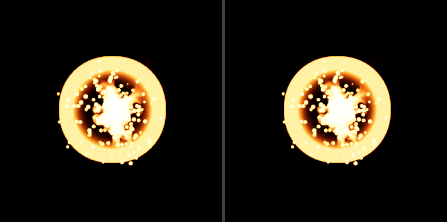

# NS_BasicHit: render nativo contra la imagen final de Unreal (T-1021-46)

2026-10-22. Retrabajo 1. Base: commit `41b956c`. Solo laboratorio (`tools/niagara-native-lab/`), sin versión nueva ni
cambio en `src/`, `server/` o `assets/`. Los tres emisores de `NS_BasicHit` salen de `BasicHitSimulation` y se dibujan con
la cadena de color final del piloto: capas instanciadas -> destino HDR de media precisión -> LUT Filmic de `film-color.js`
-> lienzo de 1024 px, contra el `FinalColorLDR` de `basichit-reference05` sin remuestreo. El gate es el de
[RENDER-SOURCES.md](RENDER-SOURCES.md), sección "Umbrales del binding BasicHit", con los umbrales leídos de
[render-sources.json](render-sources.json). Datos legibles por máquina: [render-checkpoint.json](render-checkpoint.json).
Este documento informa resultados; aceptar la etapa es palabra del autor.



## Resultado

- Precondición de transferencia (paso 12, tres cámaras): pasa en las tres, MAE 0,024 a 0,026/255 y P95 0 (umbrales 2 y 4).
- Filas nativas (15): pasan las 15. IoU de máscara mínima 0,9828 (`t0018_oblique`; umbral 0,94); MAE máxima 1,784/255
  (`t0018_oblique`; umbral 10).
- `comparison.json` de la ejecución A: `transferAccepted` true, `nativeAccepted` true, `accepted` true. Es el campo de la
  herramienta, no la aceptación del autor.
- Dos ejecuciones idénticas: `check-pixels.py` 34/34 y los dos `comparison.json` iguales byte a byte.
- Piloto sin cambios: 2261/2261 PNG idénticos a `base-a` (con la exclusión ya declarada en T-1021-22) y los cinco verify
  con sus hashes.

## Qué se construyó

Núcleo, opciones opt-in (sin su `#define`, el shader preprocesado es el del piloto; un test fija el sha256 de los shaders
preprocesados de los cuatro conjuntos de defines del piloto contra `590687c`). Detalle en
[CORE-MODULES.md](../CORE-MODULES.md), sección Render:

- `core/sprite-shader.js`: `spriteLayer({ grid, texture, depthFade, facing = 'camera-plane', subUV = 'clamp', opacity =
  'texel-red' })`; `SPRITE_FACING_MODES` (`camera-plane`, `camera-position`), `SPRITE_OPACITIES` (`texel-red`,
  `radial-gradient-exponential`), `cameraPositionBasis(cameraPosition, center)`, `RADIAL_GRADIENT_EXPONENTIAL`,
  `RADIAL_GRADIENT_EXPONENTIAL_GLSL`, `radialGradientExponential([u, v])`. Defines `SPRITE_FACING_CAMERA_POSITION`,
  `SUBUV_WRAP`, `SPRITE_RADIAL_GRADIENT`.
- `core/subuv-atlas.js`: `SUBUV_POLICIES` (`clamp`, `wrap`) y `subUVAtlasUv(subImage, [columns, rows], [u, v], policy =
  'clamp')`, con la rama `#ifdef SUBUV_WRAP` en el GLSL.

Atadura y herramientas nuevas:

- `basichit-render.js`: `BASICHIT_LAYERS` (un descriptor por emisor, en el orden del sistema), `DRAW_ORDERS` (`gate` [0, 1,
  2], `reverse` [2, 1, 0]) y `class BasicHitParticles(scene, textures, order = 'gate')` con `setOrder`, `update(frame)` y
  `dispose()`. Cada frame pasa por `validateFrame(frame, BASICHIT_FRAME_SPEC)` antes de tocar un búfer; un `subImage`
  ausente se sube como 0. `particles.js` no cambia.

| emisor | orientación | SubUV | material | color | opacidad |
|---|---|---|---|---|---|
| `NE_Flame_Basic_001` | `camera-position` (FaceCameraPosition) | 8x4, `wrap`; textura en Repeat | MI_Fireball / M_Smoke | `ParticleColor.rgb * tex.rgb` | `saturate(ParticleColor.a * tex.r)`; DepthFade apagado |
| `NE_Basic_Flash001` | `camera-plane` (FaceCamera) | 1x1 | MI_Hit_1 / M_Ground_Crack | `tex.rgb * ParticleColor.rgb` | `saturate(tex.r * ParticleColor.a)` |
| `NE_SimpleBurst` | `camera-plane` (FaceCamera) | 1x1, sin textura | MI_Radial_2 / M_Master_RadialBeam | `ParticleColor.rgb` | `saturate(ParticleColor.a * RGE(TexCoord[0]))` |

Fuentes de cada fila: `system.t3d` (Flame 3516-3521, Flash 1943-1955, SimpleBurst 5404-5407), `M_Smoke.t3d` 24-33, 38-48,
`M_Ground_Crack.t3d` 15-16, 21-22, 29-30 (la opacidad toma `.x`: `HLSLMaterialTranslator.cpp` 4122-4130 y 4964-4979),
RENDER-SOURCES.md (c) para RGE. FaceCameraPosition: `NiagaraSpriteVertexFactory.ush` 561-562, 582-583 y 617-620; FaceCamera
556-557 y 602-606. SubUV: misma ush 1059-1068 y `NiagaraRendererSprites.cpp`:552. Opacidad saturada como en UE:
`MaterialTemplate.ush` 3914-3920 (`GetMaterialOpacity = saturate(GetMaterialOpacityRaw)`), que usa el pase base translúcido
sin Substrate (`BasePassPixelShader.usf` 1012 y 1021; `r.Substrate` vale 0, `RenderUtils.cpp` 2068-2072). Texturas sRGB en
TA_WRAP (render-sources.json "textures"). Todos los materiales `BLEND_Translucent` y `MSM_Unlit`, sin cobertura de píxel ni
orden por partícula (SortMode None).

- `basichit.html` y `basichit-lab.js`: página con instante (0, 2, 6, 12, 18, 24), cámara, orden de dibujo, casilla "Aislar
  color" (solo en el paso 12) y estado `window.basicHitLab` (`ready`, `errors`, `select(step, camera, order, source)`,
  `dispose`). Lee `reference-profiled-checkpoint.json`, toma la ejecución `basichit-reference05` y comprueba el sha256 de
  cada archivo que lee (informe, texturas, HDR crudos) contra sus `runs[].files`; `film-source.json` y `basichit-source.json`
  contra sus hashes fijados. La imagen de Unreal de la izquierda se muestra con `` sin leer sus bytes;
  `compare-basichit.py` sí comprueba el sha256 de cada PNG de Unreal que compara. Semilla `seedConfiguration.fixtureSeedBase` (6371) del checkpoint. Lienzo y destino HDR de
  1024 px, `setPixelRatio(1)`, cámaras ortográficas de 850 cm de las filas `images[]` (`toScene(position_cm)`,
  `lookAt(toScene(target_cm))`, near 0,01, far 100). Las texturas se crean desde los bytes verificados con
  `createImageBitmap` (flipY, sin premultiplicar, sin conversión de color), sRGB, mipmaps trilineales.
- `qa-basichit.mjs <playwright index.mjs> <ejecución nueva>`: Chrome sin cabeza; se niega si la carpeta existe; guarda 34
  lienzos (t0000 vacío, 15 nativos en orden del gate, 3 de transferencia, 15 en orden inverso) y `browser.json` con la versión
  del navegador; comprueba solo GET locales, cero errores de consola, ninguna petición de estados capturados, que la casilla,
  el orden y el botón de reinicio solo cambian la presentación, controles en 390 px, y liberación a 0 geometrías y 0 texturas.
- `compare-basichit.py <carpeta> [--transfer-only]`: patrón de `compare-color.py`; umbrales leídos de render-sources.json
  (sha256 en el JSON); referencia comprobada contra reference-profiled-checkpoint.json. `--transfer-only` escribe
  `transfer-check.json` (identidad y transferencia, sin abrir ningún lienzo nativo). El modo completo escribe
  `comparison.json` (transferencia, nativas, identidad, diagnósticos, `thresholdsBeforeReview`) y sale con 1 si el gate
  falla, después de escribir; las filas nativas solo se calculan si pasan las tres de transferencia.
- `basichit-render.test.mjs` (5 tests) y `render-core.test.mjs` (5 tests nuevos, todas las aserciones anteriores
  intactas). La suite pasa de 53 a 63, sin fallos.

## Referencia y entrada de la transferencia: `basichit-reference05` y HDR crudo

La primera ejecución de este encargo (`.scratch/basichit-render/r01`, contra `basichit-reference03`) se detuvo en la
precondición: en el paso 12 la transferencia daba MAE 24,77/25,26/25,16 y P95 71 (frontal/oblicua/lateral), mientras su
transferencia en GPU coincidía con el Filmic exacto de JS dentro de 0,26/255. La causa (T-1022-07): `capture_reference.py`
no tenía el perfil de color del piloto (`target_gamma` del destino RGBA8, cvars, AA) y solo guardaba HDR Radiance.
T-1022-10 recapturó BasicHit con el perfil `controlled-sdr/v1` (`basichit-reference05`, repetida en `basichit-reference06`,
[REFERENCE-PROFILED.md](REFERENCE-PROFILED.md)): la transferencia fuera del navegador (`transfer-basichit.mjs`) sobre el
HDR crudo da MAE 0,121/0,126/0,122 y P95 1 en el paso 12; el Radiance del mismo paso daría unos 2,9 (solo diagnóstico).
Los estados de partículas de reference05 son iguales a los de reference03 (241/241).

Por eso, antes de la primera comparación nativa, la página, el QA y la comparación pasan a `basichit-reference05`, a su
checkpoint y al HDR crudo `frames/t0012_<cámara>_hdr.rgba16f` de cada fila (`hdr_raw`: RGBA float16 little-endian, primera
fila arriba, 1024x1024, 8.388.608 bytes, sha256 en la fila), la misma entrada del gate de color del piloto
(`color-lab.js`:71). Se decodifica como `decodeRaw` de `transfer-basichit.mjs` y se sube como textura half-float con la
comprobación de tamaño de `color-lab.js`. El Radiance ya no se lee. Esta sustitución no es un cambio tras la primera
comparación: ningún número nativo existía antes.

- Cámaras: las 16 filas de reference05 (15 imágenes y la base vacía) tienen el mismo archivo, `position_cm` y `target_cm`
  que reference03, y el mismo ancho ortográfico de 850 cm (comando en "Cómo reproducir").
- Historia: los 31 lienzos no de transferencia de `r01` son idénticos píxel a píxel a los de la ejecución A
  (`check-pixels.py` r01 contra A: 31/34; solo difieren los 3 de transferencia, que en r01 venían del Radiance de
  reference03). El render nativo no cambió con el retrabajo; cambió la referencia y la entrada de la transferencia.
- RENDER-SOURCES.md y render-sources.json no se tocan, aunque su texto de definición todavía nombra `basichit-reference03`
  y el `.hdr`: lo lleva el jefe al autor. `compare-basichit.py` lee los umbrales de render-sources.json como estaba previsto.

## Regresión de píxeles del piloto

Antes de la comparación nativa. Corridas nuevas de las seis páginas QA del piloto con el código final; sus salidas se
copiaron a `.scratch/render-core/t1021-46-r2-after/` (misma estructura que `base-a`). Las carpetas de salida fijas de esos
scripts se copiaron antes a `.scratch/render-core/t1021-46-r2-pre/` y se restauraron después con esos bytes. Chrome
155.0.8059.85, el mismo de `base-a`; Playwright 1.64.1 de `visual-revamp`.

| familia | script | PNG comparados | t1021-46-r2-after contra base-a |
|---|---|---|---|
| browser-lab | `qa.mjs` | 16 | 16/16 |
| native-birth | `qa-native.mjs` | 12 | 12/12 |
| native-update | `qa-update.mjs` | 8 | 8/8 |
| depth-lab | `qa-depth.mjs` (depth02) | 50 | 50/50 |
| color-lab | `qa-color.mjs` (color07) | 23 | 23/23 |
| atlas | `qa-atlas.mjs`, 8 variantes | 2152 | 2152/2152 |

Total `identical 2261/2261` = 2269 PNG de `base-a` menos `atlas/*/mobile-layout.png` (8), la exclusión de T-1021-22. Sin
la exclusión: 2268/2269, el mismo píxel de texto de `quarter/mobile-layout.png` (diferencia 1). Los cinco verify dan
8d46fe1f, 984ad3fe, 2b3558e2, b2e81759 y 117f90cf.

`qa-native.mjs` y `qa-update.mjs` agotaron dos veces su espera de 30 s al pasar al modo observado (`qa-native.mjs`:79,
`qa-update.mjs`:57; 241 estados pedidos a la vez). El registro del servidor muestra 191 de 241 respuestas y luego nada, y
241 peticiones simultáneas desde Python contra `python -m http.server` dan `WinError 10061` (conexión rechazada: la cola de
escucha por defecto de `socketserver` es 5, `socketserver.py`:444). Las dos corridas válidas usaron `ThreadingHTTPServer`
con `SimpleHTTPRequestHandler` (la base de la clase de `python -m http.server`, sin su mezcla de doble pila, que no cambia
nada con 127.0.0.1) y cola 128, desde la raíz del worktree; los bytes servidos no cambian. Los registros de los intentos
fallidos están en `t1021-46-r2-after/attempts/`. Las corridas de BasicHit usaron `python -m http.server` sin cambios.

## Identidad de la transferencia del laboratorio

Lienzo de transferencia de la GPU (HDR crudo -> LUT de 32³ -> lienzo) contra la transformación exacta de JS del mismo HDR
crudo (`createFilmTransform(film-source.json).encode`, como `transfer-basichit.mjs`: NaN a 0, `[0, 65504]`,
`round(clamp01 * 255)`), sobre la unión completa (canal máximo > 8 en cualquiera). La calcula `compare-basichit.py` con
`node` (diagnóstico, fuera de `accepted`; el jefe fijó detenerse por encima de 0,5/255).

| caso | MAE/255 | P95/255 | máx | píxeles de la unión |
|---|---|---|---|---|
| `t0012_front` | 0,135 | 1 | 3 | 19280 |
| `t0012_oblique` | 0,141 | 1 | 3 | 19458 |
| `t0012_side` | 0,137 | 1 | 3 | 19549 |

## Gate

Precondición de transferencia: la LUT del laboratorio sobre el HDR crudo de Unreal contra el `FinalColorLDR` de Unreal,
paso 12. Umbrales: MAE <= 2/255 y P95 <= 4/255 sobre la unión.

| caso | MAE/255 | P95/255 | máx | píxeles de la unión | resultado |
|---|---|---|---|---|---|
| `t0012_front` | 0,024 | 0 | 1 | 19280 | pasa |
| `t0012_oblique` | 0,026 | 0 | 1 | 19458 | pasa |
| `t0012_side` | 0,025 | 0 | 1 | 19549 | pasa |

La LUT de la GPU queda más cerca del LDR de Unreal (0,025) que la transformación exacta (0,12 en T-1022-10): Unreal también
pasa por una LUT de 32³.

Filas nativas, orden del gate (Flame, Flash, SimpleBurst). Umbrales: IoU de máscara (canal máximo > 32 en cada imagen) >=
0,94 y MAE sobre la unión <= 10/255. Máx = error de canal máximo en toda la imagen.

| caso | IoU de máscara | MAE/255 | máx | píxeles de la unión | UE > 32 | lab > 32 | resultado |
|---|---|---|---|---|---|---|---|
| `t0002_front` | 1,0000 | 0,796 | 100 | 813 | 805 | 805 | pasa |
| `t0002_oblique` | 0,9977 | 1,015 | 165 | 863 | 856 | 858 | pasa |
| `t0002_side` | 1,0000 | 0,476 | 25 | 900 | 896 | 896 | pasa |
| `t0006_front` | 0,9983 | 1,401 | 85 | 5256 | 5211 | 5214 | pasa |
| `t0006_oblique` | 0,9978 | 1,428 | 98 | 5459 | 5413 | 5405 | pasa |
| `t0006_side` | 0,9984 | 1,355 | 107 | 5522 | 5456 | 5457 | pasa |
| `t0012_front` | 0,9963 | 1,436 | 86 | 19295 | 18571 | 18528 | pasa |
| `t0012_oblique` | 0,9967 | 1,497 | 86 | 19473 | 18834 | 18792 | pasa |
| `t0012_side` | 0,9966 | 1,480 | 85 | 19559 | 18911 | 18871 | pasa |
| `t0018_front` | 0,9852 | 1,741 | 86 | 12631 | 10777 | 10695 | pasa |
| `t0018_oblique` | 0,9828 | 1,784 | 73 | 12724 | 10685 | 10632 | pasa |
| `t0018_side` | 0,9853 | 1,766 | 90 | 12668 | 10776 | 10727 | pasa |
| `t0024_front` | 1,0000 | 0,066 | 2 | 1125 | 1078 | 1078 | pasa |
| `t0024_oblique` | 1,0000 | 0,045 | 3 | 1127 | 1096 | 1096 | pasa |
| `t0024_side` | 0,9991 | 0,054 | 2 | 1117 | 1081 | 1082 | pasa |

Partículas nativas por paso (llama, destello, ráfaga): 2 y 6 -> 1, 1, 250; 12 -> 1, 1, 196; 18 -> 1, 0, 147; 24 -> 0, 0, 104.

## Diagnósticos (fuera de `accepted`)

Orden inverso (SimpleBurst, Flash, Flame):

| caso | IoU de máscara | MAE/255 | máx | píxeles de la unión |
|---|---|---|---|---|
| `t0002_front` | 1,0000 | 1,210 | 100 | 813 |
| `t0002_oblique` | 0,9977 | 1,418 | 165 | 863 |
| `t0002_side` | 1,0000 | 0,901 | 12 | 900 |
| `t0006_front` | 0,9983 | 1,524 | 85 | 5256 |
| `t0006_oblique` | 0,9978 | 1,526 | 98 | 5459 |
| `t0006_side` | 0,9984 | 1,500 | 107 | 5522 |
| `t0012_front` | 0,9963 | 1,418 | 86 | 19295 |
| `t0012_oblique` | 0,9967 | 1,470 | 86 | 19473 |
| `t0012_side` | 0,9967 | 1,451 | 84 | 19560 |
| `t0018_front` | 0,9852 | 1,706 | 86 | 12631 |
| `t0018_oblique` | 0,9828 | 1,738 | 73 | 12724 |
| `t0018_side` | 0,9853 | 1,721 | 90 | 12668 |
| `t0024_front` | 1,0000 | 0,066 | 2 | 1125 |
| `t0024_oblique` | 1,0000 | 0,045 | 3 | 1127 |
| `t0024_side` | 0,9991 | 0,054 | 2 | 1117 |

- El orden del gate da menos error en los pasos 2 y 6 (por ejemplo 0,796 frente a 1,210 en `t0002_front`); el inverso da
  algo menos en 12 y 18 (1,418 frente a 1,436 en `t0012_front`). En el paso 24 solo hay ráfaga y los dos órdenes dan el
  mismo lienzo. Las diferencias son pequeñas y de signo mixto: esta evidencia no decide el orden dentro de un componente.
- Base vacía `t0000_front`: canal máximo 0 en Unreal y 0 en el laboratorio.

## Dos ejecuciones idénticas

Ejecuciones `t1021-46-r2-a` y `t1021-46-r2-b` en `.scratch/basichit-render/`: `check-pixels.py` da `identical 34/34`
(todos los lienzos guardados); `comparison.json` de las dos es igual byte a byte (`cmp`, salida 0), igual que sus
`transfer-check.json`. `comparison.json` no guarda nombre de ejecución ni hora.

## Cambios tras la primera comparación

Ninguno. La primera comparación nativa es la de la ejecución A; su `comparison.json` se copió antes de seguir a
`.scratch/basichit-render/t1021-46-r2-first-comparison/` y es idéntico byte a byte al final (sha256 `3e4805fb…`). No se
cambió ningún umbral, orden, fórmula ni dato de la atadura después de verla.

## Qué queda establecido y qué no

Propuesto al autor (nada se declara aceptado sin su palabra):

- La cadena nativa del laboratorio reproduce el `FinalColorLDR` de `basichit-reference05` en los 15 encuadres del gate con
  IoU >= 0,9828 y MAE <= 1,784/255, en orden de emisores, con dos ejecuciones idénticas.
- La transferencia de la LUT del laboratorio sobre el HDR crudo pasa con MAE <= 0,026/255 y P95 0, y la transferencia de la
  GPU es idéntica a la exacta de JS dentro de 0,141/255.
- Las opciones nuevas del núcleo no cambian ningún píxel del piloto (2261/2261) ni los cinco verify.

No establecido:

- Aceptación visual o artística: es del autor.
- DepthFade de la llama contra una superficie: la referencia no tiene superficie y la llama se dibuja sin DepthFade (caso
  "none" del piloto). Medido después (T-1023-06, [DEPTH.md](DEPTH.md)): contra los 13 planos opacos de
  `basichit-reference12` (pasos 6 y 12) la llama con DepthFade de 100 cm pasa las 32 filas con IoU >= 0,9939 y MAE <=
  1,513/255 (2 con la unión visible vacía), y sin DepthFade `t0012_side_wall0` falla; el gate de esta entrega no se ha movido.
- El SubUV en wrap más allá de la rejilla: los pasos del gate tienen `subImage` 3,33, 10, 20 y 30, sin llama en el 24; la
  fórmula está fijada solo por tests. Medido después (T-1022-35, [WRAP.md](WRAP.md)): en los pasos 20 a 23 (`subImage`
  33,3 a 38,3) la cadena con `wrap` pasa los 12 encuadres de `basichit-reference10` y la `clamp` del piloto cae a IoU
  0,74-0,86 y MAE 12-23/255; el gate de esta entrega no se ha movido.
- El orden de dibujo entre emisores dentro de un mismo componente (ver diagnósticos); el gate usa el de los emisores.
  Medido después (T-1022-32 y T-1022-33, [DRAW-ORDER.md](DRAW-ORDER.md)): el motor dibuja Flash, SimpleBurst, Flame y ese
  orden da el menor error en los 9 encuadres donde los tres órdenes difieren; el gate de esta entrega no se ha movido.
- Los mipmaps: los genera el controlador desde el PNG exportado; los de Unreal no se compararon.
- Bloom, grading u otro aspecto del juego: el perfil es el de laboratorio. Pasos posteriores al 24, otras semillas, KTX2,
  presupuesto móvil, integración en el juego.
- El texto de definición de RENDER-SOURCES.md y render-sources.json sigue nombrando `basichit-reference03` y el `.hdr`.

## Evidencia

| archivo | sha256 |
|---|---|
| `.scratch/basichit-render/t1021-46-r2-a/comparison.json` | `3e4805fbbc84a1c5954cc89a9c6b586245c54285307cf761b179e0d47ae32be9` |
| `.scratch/basichit-render/t1021-46-r2-a/transfer-check.json` | `10d11365a17459368940336bdcbbd446f57940deec12262ff27d3e83befa153d` |
| `.scratch/basichit-render/t1021-46-r2-first-comparison/comparison.json` | `3e4805fbbc84a1c5954cc89a9c6b586245c54285307cf761b179e0d47ae32be9` |
| `docs/delivery/st01c/basichit/reference-profiled-checkpoint.json` | `1c77f5042d3116461eb387efc17f8a45ae817a23abe59b6a91400dfb2193dd17` |
| `docs/delivery/st01c/basichit/render-sources.json` | `64cdefc1b6e090a32d737b0962ab4f0c2acc3bbc326d9041498a831ee3c9e99c` |
| `docs/delivery/st01c/basichit/render-hero-t0012-front.png` | `54a8db028f18ee1ffc8b25d91b8be0fc4602ba4414a0a542eaf99d65641006d3` |

[render-checkpoint.json](render-checkpoint.json) copia las filas de `comparison.json` y fija el sha256 de cada archivo de
las ejecuciones A y B (lienzos, `browser.json`, `comparison.json`, `transfer-check.json`), de la primera comparación, de la
imagen de portada y de los nueve archivos de código. Otras carpetas: `.scratch/render-core/t1021-46-r2-after` y
`t1021-46-r2-pre` (regresión del piloto), `.scratch/basichit-render/r01` (primera ejecución, historia).

## Cómo reproducir

Desde cualquier shell de Git Bash, con `python -m http.server 5197 --bind 127.0.0.1` corriendo desde la raíz del worktree
(detenerlo por su PID). Son los comandos que se corrieron; `qa-basichit.mjs` se niega con una carpeta que ya existe, así
que para repetir hay que dar nombres nuevos en lugar de `t1021-46-r2-a` y `t1021-46-r2-b`.

```bash
W="C:/DEV/real of trade/st01c-native"
PW="C:/DEV/real of trade/visual-revamp/node_modules/playwright/index.mjs"
node --test "$W"/tools/niagara-native-lab/*.test.mjs
for s in verify-core verify-native verify-update verify-depth verify-basichit; do node "$W/tools/niagara-native-lab/$s.mjs" 2>&1 | sha256sum | cut -c1-8; done
node "$W/tools/niagara-native-lab/qa-basichit.mjs" "$PW" t1021-46-r2-a
python -B "$W/tools/niagara-native-lab/compare-basichit.py" "$W/.scratch/basichit-render/t1021-46-r2-a" --transfer-only
python -B "$W/tools/niagara-native-lab/compare-basichit.py" "$W/.scratch/basichit-render/t1021-46-r2-a"
node "$W/tools/niagara-native-lab/qa-basichit.mjs" "$PW" t1021-46-r2-b
python -B "$W/tools/niagara-native-lab/compare-basichit.py" "$W/.scratch/basichit-render/t1021-46-r2-b"
python -B "$W/tools/niagara-native-lab/check-pixels.py" "$W/.scratch/basichit-render/t1021-46-r2-a" "$W/.scratch/basichit-render/t1021-46-r2-b"
cmp "$W/.scratch/basichit-render/t1021-46-r2-a/comparison.json" "$W/.scratch/basichit-render/t1021-46-r2-b/comparison.json"
python -B "$W/tools/niagara-native-lab/check-pixels.py" "$W/.scratch/render-core/base-a" "$W/.scratch/render-core/t1021-46-r2-after" --exclude 'atlas/*/mobile-layout.png'
env -C "$W" python -c "import json; f=lambda r: (lambda d: ({(i['step'], i['camera']): (i['file'], i['position_cm'], i['target_cm']) for i in d['images'] + [d['empty_baseline']]}, d['settings']['orthographic_width_cm']))(json.load(open('.scratch/unreal/' + r + '/capture-report.json', encoding='utf-8'))); a, b = f('basichit-reference03'), f('basichit-reference05'); print(a == b, len(a[0]), a[1])"
```

Salida de la última línea: `True 16 850.0`. Una carpeta nueva de regresión del piloto se arma como en T-1021-22: correr
`qa.mjs`, `qa-native.mjs`, `qa-update.mjs`, `qa-depth.mjs`, `qa-color.mjs` (salidas en sus carpetas fijas de `.scratch`,
copiar antes lo que haya) y `qa-atlas.mjs "$PW" <ejecución nueva>`, y copiar a la nueva carpeta solo los archivos que
escribió cada corrida, con la estructura de `base-a`.
