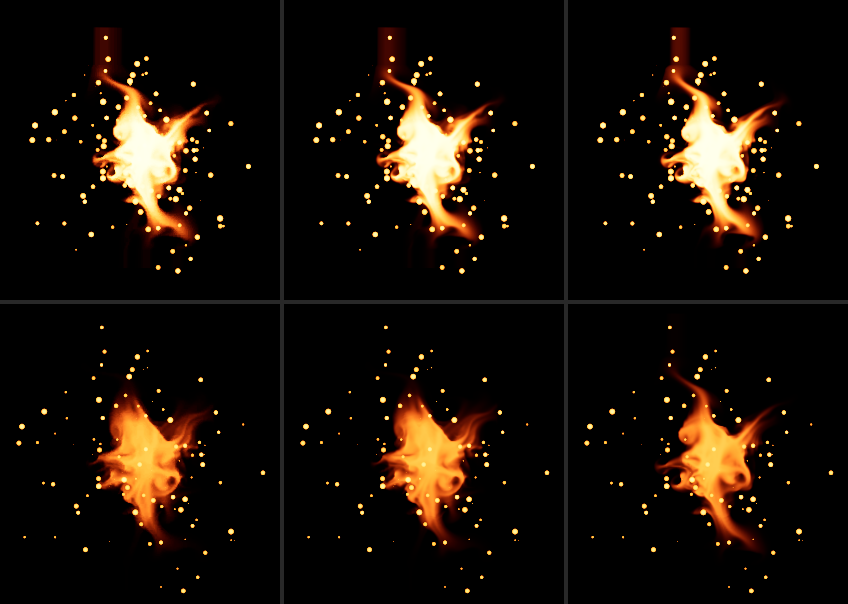

# NS_BasicHit: el SubUV de la llama más allá de la rejilla (T-1022-35)

Pendiente de RENDER.md ("el SubUV en wrap más allá de la rejilla: los pasos del gate tienen `subImage` 3,33, 10, 20 y
30, sin llama en el 24; la fórmula está fijada solo por tests"). La llama (`NE_Flame_Basic_001`) recorre 40 fotogramas
sobre una rejilla de 8x4 = 32 celdas; en los pasos 20 a 23 su `subImage` vale 33,3 a 38,3. Esta entrega captura esos
pasos en Unreal con el perfil controlado y los compara con la cadena nativa, con la fórmula `wrap` del gate y con la
`clamp` del piloto como diagnóstico. Nada de lo que sigue mueve el gate de RENDER.md ni sus umbrales.



Arriba el paso 20, abajo el 23; de izquierda a derecha: Unreal (`FinalColorLDR` de `basichit-reference10`), cadena
nativa con `wrap`, cadena nativa con `clamp` (recorte de 280 x 300 px de los lienzos de 1024 px de `t1022-35-wrap-a`).

## Resultado

- Unreal lee la celda `subImage mod 32` sin recortar: la cadena nativa con `wrap` pasa los 12 encuadres de los pasos 20 a
  23 con los umbrales del gate (IoU de máscara >= 0,9830 frente a 0,94; MAE <= 1,679/255 frente a 10).
- Con `clamp` (la celda 31 en los cuatro pasos) los mismos 12 encuadres caen a IoU 0,736-0,861 y MAE 12,4-22,7/255:
  fallarían los dos umbrales. La diferencia la decide la referencia, no solo los tests.
- La precondición de transferencia pasa en el paso 20 en las tres cámaras (MAE <= 0,038/255, P95 0).
- Dos ejecuciones del laboratorio idénticas (`t1022-35-wrap-a` y `-b`: 52/52 lienzos, `comparison.json` y
  `transfer-check.json` byte a byte); dos capturas de Unreal idénticas (`basichit-reference10` y `-11`). El gate de
  RENDER.md no cambia: dos ejecuciones nuevas (`t1022-35-gate-a` y `-b`) dan 49/49 lienzos iguales a `t1022-33-c` y el
  mismo `comparison.json` (`ffd36cdb...`).

## La fórmula

`core/subuv-atlas.js` (T-1021-46), rama `SUBUV_WRAP` y su gemela en JS: `NiagaraSpriteVertexFactory.ush` (UE 5.8)
1059-1068, `SubImageA = SubImageIndex - frac(SubImageIndex) + 0,5`, columna `floor(fmod(A, 8))`, fila `floor(A / 8)` sin
recorte; con la textura en Repeat (TA_WRAP), la fila 4 vuelve a la 0. `clamp` (el del piloto) recorta a la última celda.
Celdas leídas por la llama (`BasicHitSimulation`, semilla 6371):

| paso | `subImage` | alfa de la partícula | celda `wrap` | celda `clamp` |
|---|---|---|---|---|
| 18 (gate) | 30,000 | 0,158 | 30 | 30 |
| 20 | 33,333 | 0,075 | 1 | 31 |
| 21 | 35,000 | 0,044 | 3 | 31 |
| 22 | 36,667 | 0,020 | 4 | 31 |
| 23 | 38,333 | 0,005 | 6 | 31 |

El alfa baja casi a cero, pero el color de la llama es HDR (3236, 394, 51): aun con alfa 0,005 la llama satura tras el
Filmic y su silueta es la de la celda. En el paso 24 la llama ya no existe.

## Referencia: `basichit-reference10` y `-11`

`tools/unreal-niagara-probe/systems/ns-basichit-wrap.json` es `ns-basichit.json` con solo `capture.imageSteps`
[20, 21, 22, 23] y `capture.linearStep` 20 (`capture_spec_test.py` comprueba que nada más difiere). Mismo controlador
(`capture_reference_profiled.py`), envoltorio y perfil `controlled-sdr/v1` que REFERENCE-PROFILED.md; 12 imágenes más la
base vacía, 13 HDR crudos, 241 estados. `build_wrap_checkpoint.py` usa `build_profiled_checkpoint.py` como biblioteca, sin
cambiarlo (su texto está fijado en `reference-profiled-checkpoint.json`), y escribe
[wrap-reference-checkpoint.json](wrap-reference-checkpoint.json); `check_profiled_checkpoint.py` con esa ruta da
`RESULT OK`: par igual (13/13 PNG con 0 píxeles distintos, 13/13 HDR crudos y 3/3 Radiance byte a byte), 241/241 estados
de partículas idénticos a `basichit-reference03` y 4/4 texturas, perfil leído de vuelta, 14 hashes de código y el binario
del plugin. El checkpoint del gate sigue en `RESULT OK`.

Intentos que no son la referencia final (registrados en el checkpoint, `attempts`):

1. `basichit-reference07` (1405,2 s, fallido): el editor arrancó a 4-5 FPS (33,7-37,8 en las corridas anteriores),
   `FWaitForInteractiveFrameRate` agotó sus 600 s y el test cayó en el límite de 540 s con 24 de 241 estados y sin
   `capture-report.json`. A la vez, el Chrome sin cabeza de otra sesión (visual-revamp) usaba unos 7 núcleos con
   SwiftShader; el editor usaba 0,19 núcleos y nada de disco. El siguiente arranque, con la máquina en reposo, llegó a
   32,2 FPS en 5 s. Se deja en `.scratch/unreal` como evidencia.
2. `basichit-reference08` y `-09` (61,7 y 64,4 s, completos): `capture_code` registró los bytes con CRLF de
   `capture_reference_profiled.py` y `capture_profile.py` (checkout con `core.autocrlf`), así que el comprobador rechaza la
   sección del perfil aunque su texto LF es el fijado. `.gitattributes` fija ahora `eol=lf` para esos dos archivos (el
   contenido en git no cambia) y el par se capturó de nuevo: `basichit-reference10` (57,9 s) y `-11` (54,4 s).
   `compare_reference_runs.py` da `-08` igual a `-10` (13/13 PNG con diferencia 0): el problema era solo el hash.

## Gate en los pasos 20 a 23

`basichit.html?reference=wrap` lee `basichit-reference10` a través de `wrap-reference-checkpoint.json`; pasos y paso de
transferencia salen de sus `settings` (`imageSteps`, `linearStep`). `qa-basichit.mjs <playwright> <ejecución> wrap` guarda
52 lienzos (12 nativos y la base vacía, 3 de transferencia, 12 inversos, 12 del motor, 12 `clamp`) y
`compare-basichit.py <ejecución> --reference wrap` aplica los umbrales de `render-sources.json` (los mismos números del
gate; solo el paso de transferencia sale del checkpoint). IoU de máscara / MAE (/255) / canal máximo:

| caso | nativo `wrap`, orden gate | orden del motor (= inverso) | `clamp` (diagnóstico) |
|---|---|---|---|
| `t0020_front` | 0,9844 / 1,663 / 81 | 0,9844 / 1,638 / 81 | 0,8606 / 12,570 / 255 |
| `t0020_oblique` | 0,9830 / 1,660 / 79 | 0,9830 / 1,626 / 79 | 0,8564 / 12,434 / 254 |
| `t0020_side` | 0,9843 / 1,679 / 74 | 0,9843 / 1,642 / 74 | 0,8571 / 12,409 / 254 |
| `t0021_front` | 0,9833 / 1,502 / 58 | 0,9833 / 1,477 / 58 | 0,7692 / 20,567 / 255 |
| `t0021_oblique` | 0,9840 / 1,565 / 68 | 0,9840 / 1,538 / 68 | 0,7642 / 20,401 / 255 |
| `t0021_side` | 0,9840 / 1,542 / 51 | 0,9840 / 1,510 / 51 | 0,7601 / 20,449 / 255 |
| `t0022_front` | 0,9873 / 1,604 / 56 | 0,9873 / 1,585 / 56 | 0,7866 / 22,625 / 255 |
| `t0022_oblique` | 0,9874 / 1,612 / 59 | 0,9874 / 1,592 / 59 | 0,7851 / 22,389 / 255 |
| `t0022_side` | 0,9865 / 1,627 / 55 | 0,9865 / 1,602 / 55 | 0,7808 / 22,569 / 255 |
| `t0023_front` | 0,9898 / 1,399 / 41 | 0,9898 / 1,390 / 41 | 0,7408 / 22,599 / 255 |
| `t0023_oblique` | 0,9907 / 1,391 / 48 | 0,9907 / 1,384 / 48 | 0,7382 / 22,494 / 255 |
| `t0023_side` | 0,9870 / 1,425 / 45 | 0,9870 / 1,410 / 45 | 0,7362 / 22,655 / 255 |

Transferencia en el paso 20 (Filmic del laboratorio sobre el HDR crudo frente al LDR de Unreal): MAE 0,035 / 0,038 /
0,037 y P95 0 (front, oblique, side); identidad de la GPU frente a la transformación exacta de `film-color.js`: MAE
0,146-0,150, P95 1. Base vacía: canal máximo 0 en Unreal y en el laboratorio.

En estos pasos el destello ya no existe, así que el orden del motor (Flash, SimpleBurst, Flame) dibuja igual que el
inverso y da algo menos de error que el del gate en los 12 encuadres, como en DRAW-ORDER.md.

## Qué queda establecido y qué no

- Establecido: con el perfil controlado, Unreal 5.8 lee la celda `subImage mod 32` de la llama más allá de la rejilla, y
  la cadena nativa con la fórmula `wrap` lo reproduce dentro de los umbrales del gate; el `clamp` no.
- Sin cambios: el gate de RENDER.md (pasos 2-24, orden de emisores, `render-checkpoint.json`) y sus umbrales. Estos 12
  encuadres no se añaden al gate; si el autor quiere, se pueden sumar con la misma herramienta.
- No establecido: aceptación visual o artística (es del autor); el `bSubImageBlend` (falso en los tres emisores, el
  laboratorio no mezcla fotogramas); mipmaps de Unreal; otras semillas o más pasos; KTX2 y presupuesto móvil.

## Evidencia

| archivo | sha256 |
|---|---|
| `.scratch/basichit-render/t1022-35-wrap-a/comparison.json` | `5e87ea9aa9a83cb90b52c6e65e8ef636158ae8b67ed930f79846499e0cb31042` |
| `.scratch/basichit-render/t1022-35-wrap-b/comparison.json` | `5e87ea9aa9a83cb90b52c6e65e8ef636158ae8b67ed930f79846499e0cb31042` |
| `.scratch/basichit-render/t1022-35-wrap-a/transfer-check.json` | `c1b648aa7e0a57ad2adb8f1f58419286e37ca40fe3d0814a657b6a1eb3a86eca` (igual en `-b`) |
| `.scratch/basichit-render/t1022-35-gate-a/comparison.json` y `-b` | `ffd36cdb7282a1c0ccc15372628f586177fc6986b32c570c04751a1697d7a5ec` (igual que T-1022-33) |
| `docs/delivery/st01c/basichit/wrap-reference-checkpoint.json` | `a784bdf67b28945a4cc157111ffffed42228147139135b705985ab1e49268851` |
| `docs/delivery/st01c/basichit/wrap-hero-t0020-t0023-front.png` | `ed536d7d8ce48251b34eca3991b6d3ab4b95bc81d4752bc76c0f79b3f057ec6f` |
| `tools/unreal-niagara-probe/systems/ns-basichit-wrap.json` (bytes capturados, CRLF) | `b5a5b5644565b52d92e74553833a3f48bc872a00648171049d8a81a25f5883d1` |

Tests del laboratorio 63/63, `capture_spec_test.py`, `capture_profile_test.py` y `atlas_build_test.py` OK. UE
5.8.0-55116800, Chrome 155, Playwright 1.64.1 de `visual-revamp`, servidor `serve.py`.

## Cómo reproducir

Capturas (PowerShell, una instancia de Unreal a la vez, nombres nuevos; el envoltorio es el de REFERENCE-PROFILED.md):

```powershell
& 'C:/Program Files/Epic Games/UE_5.8/Engine/Binaries/Win64/UnrealEditor-Cmd.exe' 'C:/DEV/real of trade/st01c-native/.scratch/unreal/ST01c_Pilot.uproject' -d3d11 -RenderOffscreen -unattended -nop4 -nosplash -nosound '-ExecCmds=Automation RunTests Editor.Python.ST01c_Pilot.test_st01c_reference_profiled' '-TestExit=Automation Test Queue Empty' -CaptureRun=basichit-reference10 '-SystemSpec=C:/DEV/real of trade/st01c-native/tools/unreal-niagara-probe/systems/ns-basichit-wrap.json'
python -B tools/unreal-niagara-probe/build_wrap_checkpoint.py --spec tools/unreal-niagara-probe/systems/ns-basichit-wrap.json --a .scratch/unreal/basichit-reference10 --b .scratch/unreal/basichit-reference11 --base .scratch/unreal/basichit-reference03 --out docs/delivery/st01c/basichit/wrap-reference-checkpoint.json
python -B tools/unreal-niagara-probe/check_profiled_checkpoint.py docs/delivery/st01c/basichit/wrap-reference-checkpoint.json
```

Laboratorio (Git Bash, con `serve.py` en 127.0.0.1:5197):

```bash
W="C:/DEV/real of trade/st01c-native"
PW="C:/DEV/real of trade/visual-revamp/node_modules/playwright/index.mjs"
node "$W/tools/niagara-native-lab/qa-basichit.mjs" "$PW" <ejecución-nueva> wrap
python -B "$W/tools/niagara-native-lab/compare-basichit.py" "$W/.scratch/basichit-render/<ejecución-nueva>" --reference wrap --transfer-only
python -B "$W/tools/niagara-native-lab/compare-basichit.py" "$W/.scratch/basichit-render/<ejecución-nueva>" --reference wrap
```

Las filas `clamp` están en `diagnostics` de `comparison.json` (`kind` "Flame SubUV clamp policy of the pilot instead of
wrap (diagnostic)"); `reference` lleva `set`, `imageSteps` y `transferStep` solo en el conjunto `wrap`, para que el
`comparison.json` del gate siga byte a byte igual.
