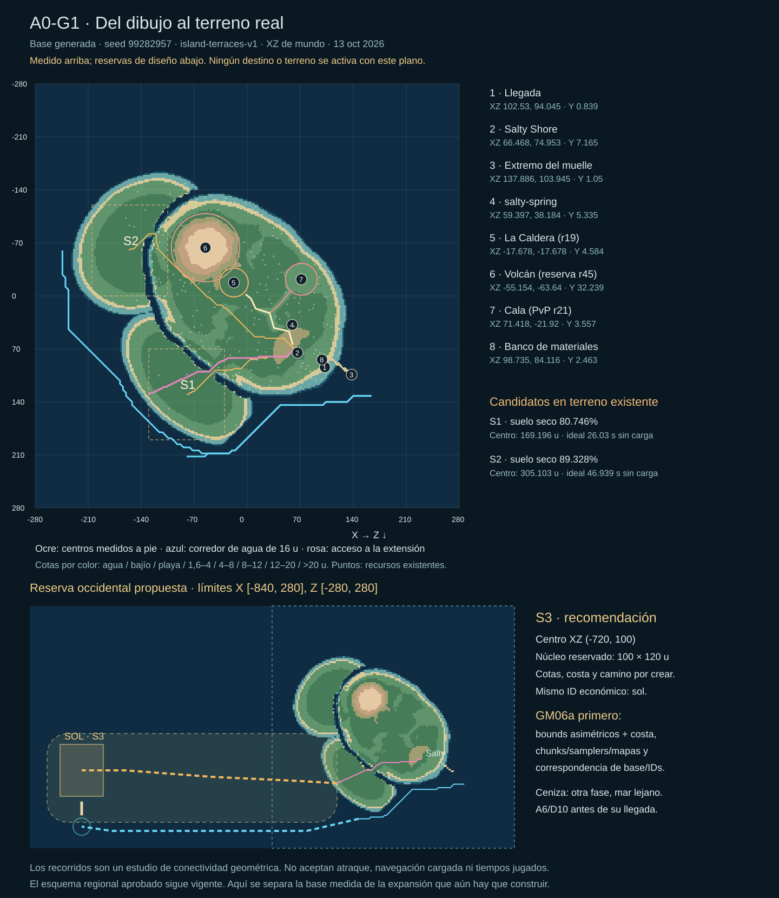

# A0-G1 — levantamiento de la base y emplazamiento de Puerto Sol

Fecha: 2026-10-13, México. Base inspeccionada: `a7cf225ba548c28581045f5b8b02def587cdebf5`,
alpha.69/protocolo 61. Continúa el [diseño aprobado](../../../PLAN-REGION-INICIAL.md)
y conserva el [plano de relaciones](../region-inicial-v1.svg).

**Resultado:** la base de 560 u admite lugares para una maqueta pequeña, pero los dos
emplazamientos comparados acortan mucho el recorrido terrestre previsto. Se recomienda
reservar Puerto Sol al oeste, en una extensión de la misma isla, antes de construir su
puerto. Esto requiere **GM06a**: costa nueva y límites asimétricos. Las coordenadas de
esa extensión son una propuesta concreta para el próximo corte; aún no existe allí terreno.

[Plano sobre terreno medido](terrain-survey.svg) · [Datos completos](survey.json) ·
[Generador del estudio](../../../tools/survey-initial-region.mjs)

## 1. Qué se midió

El estudio importa `generateWorld(GAME.seed)` sin levantar servidor ni cargar `.env`.
Semilla `99282957` (`0x5eaf00d`), revisión `island-terraces-v1`, rejilla 561×561 a 1 u.
Bounds XZ `[-280,280] × [-280,280]`; locomoción/costa tienen borde de seguridad en ±278.
El campo de alturas ocupa 1.258.884 bytes y tiene SHA-256
`b51b35d58bf2c39c3262f7ca83b912fae8c5ae3e4c66d9541d026e32b45c45f2`.

Se registran 29 anclas funcionales, 1.259 props, 773 colisionadores y **206 recursos
actuales**, incluidas las vetas añadidas después del censo S21 de 176. `survey.json`
conserva sus IDs/coordenadas, hashes de inventarios, NPCs/checkpoints, senderos y fuentes
usadas. Y representa suelo consultado, no la altura de los modelos ni sus entradas.

La consulta pública durante el corte devolvió alpha.69, cero errores, almacenamiento
Supabase durable y contenido GM generación 8 con `revisionId: null`; el enlace de release
del VPS era `a7cf225…`. Es consistente con estudiar la base sin overlay activo. No se
modificó contenido, configuración o servidor; esas lecturas no aceptan una ruta jugada.

## 2. Anclas que se conservan

Todas las cifras son XZ de mundo, **no UV ni píxeles del dibujo aprobado**. Tabla abreviada;
el JSON incluye las demás anclas, los tres puntos del circuito naval y la batería actual.

| Identidad actual | X | Z | Suelo Y | Huella/función que se conserva |
|---|---:|---:|---:|---|
| `spawn` | 102,530 | 94,045 | 0,839 | Llegada y checkpoint; sin encuentro forzado |
| `village` / mercado `aldea` | 66,468 | 74,953 | 7,165 | Mismo mercado; radio comercial actual 22 u, terrazas y edificios existentes |
| `dockBase` | 112,430 | 84,146 | 1,050 | Muelle actual de 32,249 u, semiancho 1,7 u |
| `dockEnd` | 137,886 | 103,945 | 1,050 | Salida, ingreso y retorno naval existentes |
| `salty-spring` | 59,397 | 38,184 | 5,335 | Fuente con radio 3 u, mismo ID/agua/recipientes |
| `arena` | -17,678 | -17,678 | 4,584 | La Caldera, radio 19 u, puerta/combate/checkpoint |
| `volcano` | -55,154 | -63,640 | 32,239 | Volcán/lava; el estudio evita un radio de 45 u |
| `cala` | 71,418 | -21,920 | 3,557 | Zona PvP radio 21 u, ruta y checkpoint propios |
| `resource:bench` | 98,735 | 84,116 | 2,463 | Banco existente, sin trasladar recursos para despejarlo |

Los radios de exclusión del estudio sirven para buscar alternativas; **no reemplazan**
las protecciones más amplias de S21/GM05. El mercado `sol` sigue sin `walkable` ni ancla
física, y `ISLANDS.sol.at` sigue siendo un punto del mapa económico legacy. No usarlo
como posición física ni cambiar `island` para simular que ya se puede caminar hasta Sol.

## 3. Comparación de lugares existentes

Se comparó una reserva de núcleo de **100×120 u** en cada península. Porcentaje seco:
muestras cada 2 u con Y≥0,75. «De pie» añade `canStand`, no pendiente/puerta/edificio.
Las rutas son centros geométricos en la base, sin enemigos simulados.

| Candidato | Centro XZ | Suelo seco / de pie | Cotas de la reserva | Camino de centro | Ideal sin carga / carga 1 / carga 2 |
|---|---|---|---|---:|---|
| S1, península sur | (-80,130) | 80,746 % / 80,521 % | -7,500…6,898 | 169,196 u | 26,030 / 37,186 / 65,075 s |
| S2, península oeste | (-155,-60) | 89,328 % / 88,782 % | -5,263…7,053 | 305,103 u | 46,939 / 67,056 / 117,347 s |

Son opciones para rincones o reservas posteriores, pero no se eligen como Puerto Sol:
parte de cada núcleo cae en agua y ambos quedan cerca de Salty a velocidad ordinaria.
S1 contiene 13 colisionadores y cinco recursos; S2, 38 y veinte. Convertir sus reservas
enteras en ciudad requeriría resolver esos elementos y la costa, incluso sin ampliar bounds.
No se concluye que sea imposible otro trazado dentro de 560 u: no se hizo una búsqueda
exhaustiva. Se evita diseñar rodeos artificiales solo para aumentar la duración.

El acceso geométrico hacia la extensión termina en **(-130,130), Y 2,622**, tras 219,196 u.
En el chequeo lateral a ±3 u fallan 94 de 546 muestras; S1 falla 89/421 y S2, 167/757.
Hay centros conectados, **todavía no una carretera continua de 6 u**. A0-G2 tendrá que
resolver anchura, pendientes y obstáculos sin mover las identidades protegidas.

## 4. Puerto Sol recomendado: reserva S3

Reservar un centro en **(-720,100)**, con núcleo 100×120 u y extensión X `[-840,280]`,
Z `[-280,280]`. X crece 560 u hacia el oeste; los otros extremos permanecen. Salty y Sol
siguen en la misma isla. La franja tenue del plano es una **reserva de composición**,
no una costa futura calculada ni una orden de rellenar todo el rectángulo.

| Reserva propuesta | XZ / dimensiones | Cota a diseñar |
|---|---|---|
| Núcleo de Sol | Centro (-720,100), 100×120 u | Terrazas bajas; referencia inicial 2,4 u |
| Mercado/plaza | (-710,110), radio comercial propuesto 22 u; plaza 36×36 u | Nivel común y entrada desde camino/puerto |
| Tejidos | (-745,90), 20×20 u | Espacio reservado; no crea aún producción nueva |
| Servicio/abastecimiento | (-685,75), 18×18 u | Conexión clara; contenido funcional en A3b |
| Acceso al muelle | (-720,172) → (-720,204), semiancho 3 u | Referencia de cubierta 1,05 u y rampa desde el pueblo |
| Maniobra | (-720,230), radio de reserva 20 u | Agua y despeje por validar con el casco del corte |

Estas huellas no se solapan entre plaza, tejidos y servicio; faltan edificios, puertas,
caminos internos, luz municipal y ensayos de cámara/cuerpos. Mantener ciudad/mercado
**`sol`**; no crear una segunda economía ni entregar stock por colocar un POI.

Propuesta de camino: conexión existente → (-210,125) → (-420,115) → (-620,100) → Sol.
El tramo dibujado nuevo mide 590,956 u; con el acceso medido, **810,152 u**. A 6,5 u/s
y multiplicadores actuales da 124,639 / 178,055 / 311,597 s según carga 0/1/2.
Es una previsión sin aceleración, servicios ni encuentros: encaja en el objetivo de
2–4 min para carga ordinaria/1; carga 2 supera ese objetivo y se revisará al probar.
La distancia directa mínima Salty–S3 es 786,867 u, frente a los saltos cortos S1/S2.

La unión dentro del dominio previo se reserva en X `[-280,-130]`, Z `[95,170]`.
El censo encontró **cero props, colisionadores, recursos, enemigos o anclas** en esa banda.
GM06a deberá comprobar el borde exacto y preservar su suelo seco: puede proponer costa
en celdas antes húmedas, no regenerar el resto de la isla ni desplazar su contenido.
Fuera de esa banda hay dos vetas en la reserva amplia occidental (`mine-594`, `mine-728`);
se conservan. El rectángulo visual no autoriza enterrarlas ni recolocarlas.

## 5. Aproximación por mar

El estudio parte de un punto de agua **(164,132)**, próximo a la salida actual. No mide
el ingreso del barco desde su plaza del muelle hasta ese punto. S1 tiene un corredor
geométrico de 277,137 u hasta (-80,212); S2, 616,098 u hasta (-244,-60).

Se reservó una sección de 16×16 u con fondo al menos 1 u bajo el agua, usando celdas de
1 u, corrección de costa del runtime, margen de borde y AABB conservador del muelle.
Una comprobación independiente contra `createNavalCoast` encontró cero polígonos en
las secciones de **629 y 1.402 muestras** respectivas, separadas como máximo 0,5 u.
Cinco muestras de profundidad por sección dieron mínimos de 3,510 y 2,430 u.
La profundidad de 1 u es una reserva del estudio, **no una regla actual de calado**.

Desde el extremo S1 se propone continuar por (-200,240) → (-440,240) → (-650,240) →
la maniobra de Sol. Ese tramo aún no generado mide 643,934 u; total aproximado
**921,071 u**, sin salida/atraque. Solo la parte existente tiene comprobación de costa.
No se deduce tiempo marítimo dividiendo por una velocidad arbitraria: viento, carga,
casco, timón, giro, contacto y desembarco requieren navegación real en A0-G2/A3.
Los 90–180 s siguen como objetivo revisable, no como resultado.

Bahía Ceniza queda fuera de estos bounds y de este estudio. Su distancia y terreno
se dimensionan en A4, con mar abierto y combate naval A6/D10 antes de la llegada.

## 6. Matriz de continuidad

| Elemento | Acción del siguiente corte |
|---|---|
| Base seca actual, llegada, Salty, fuente, Caldera, Cala y circuito naval | Conservar coordenadas/función; no regenerar semilla ni reordenar arrays legacy |
| 206 recursos, casas/parcelas, agua, progreso y mercados | Conservar IDs/estado; sin restock, premios ni reconstrucción desde decoración |
| Tierra/costa occidental y servicios físicos de Sol | Añadir sobre base versionada, con anclas explícitas y huellas separadas |
| Correspondencia de base GM | Diseñar migración por ID antes de activar; `gmBaseId` incorpora transformación/índice/revisión |
| Editor GM05/SQL031/033 | Mantener lectura de documentos históricos de 561×561; no reinterpretar sus índices como otra rejilla |
| Bounds/samplers/renderer/colisión/cartografía | Extender juntos; eliminar dependencia de `half` cuadrado/clamp fuera del dominio en el adaptador nuevo |
| Viajes económicos legacy, poses guardadas y ensayos en memoria | Contrato explícito de continuidad/recuperación antes del puerto multipuerto, con AREA15 |
| Centinelas de luz/agua/combate | Reservar espacios; no convertir props en servicios ni poblar rutas por este censo |

## 7. Siguiente corte: GM06a, contrato y prototipo privado

Primero adaptar una extensión versionada y acotada, con la isla existente como tile
conservado y una franja occidental. Evaluar dos tiles de 560 u y resolución local de 1 u,
frente a samplers rectangulares/chunks: dos rejillas 561×561 usan 2.517.768 bytes de
alturas, sin contar legacy, índices, normales, colisión o GPU. Un cuadrado uniforme
1120 u elevaría ese campo a 5.026.564 bytes y añadiría filas oceánicas innecesarias.
Estas cuentas no son medidas de FPS o memoria completa; no eligen aún el formato final.

El contrato debe cerrar: seams/costa/agua, consulta fuera de bounds, resolución, obstáculos,
índices de borradores históricos, identidad previa/nueva, samplers compartidos, cache del
atlas y admisión en servidor. El prototipo empieza privado y no habilita mercado o viajes.
Después A0-G2: relieve/camino/puerto provisional y recorrido con inputs normales, de día
y noche, PC/touch, carga representativa; luego A3b/AREA07/08 para mercado y carga reales.

Reutilización: este corte usa alturas, colisiones y datos existentes; no necesita exportar
arte. El kit de costa/muelle actual sigue como primera maqueta. Muelle/faro/puestos finales
se cotejarán con los candidatos Unreal/FAB al abrir su corte visual, como exige el plan.

## 8. Evidencia y límites del cierre

- Generador ejecutado dos veces con resultados JSON/SVG byte idénticos; hash de alturas
  idéntico antes/después. No carga credenciales, escribe perfiles o registra contenido GM.
- Lectura del código y revisión independiente del cribado de costa; se incorporó la
  corrección de saddle, celdas de borde y comprobación contra polígonos del runtime.
- SVG renderizado e inspeccionado en Chrome: 71 textos, cero errores de parseo o textos
  fuera del lienzo. Enlaces locales y `git diff --check` comprobados al cerrar.
- No hay código nuevo de juego, SQL, flags, versión/protocolo o geografía activada.
  El estudio acepta **A0-G1**, no Puerto Sol caminable, atraque, carretera de 6 u,
  navegación cargada, tiempos humanos ni capacidad de servidor.

Reproducir con `node tools/survey-initial-region.mjs .scratch/a0-g1-repeat` desde el repo;
el commit registrado será el de esa ejecución. El JSON fija hashes de fuentes para detectar
si se compara una base distinta. Fuentes principales:
[generación](../../../src/sim/worldgen.js), [postpass S21](../../../src/sim/terrainRevamp.js),
[locomoción](../../../src/sim/systems/movement.js), [costa](../../../src/sim/naval/coastGeometry.js),
[protección GM05](../../../src/editor/terrainData.js), [cartografía](../../../src/ui/cartography.js),
[identidad GM](../../../src/editor/baseIdentity.js) y [pueblos](../../../src/data/towns.js).
